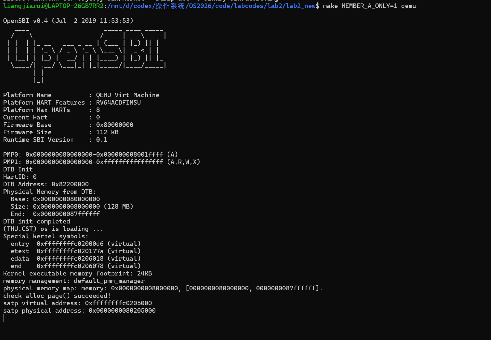
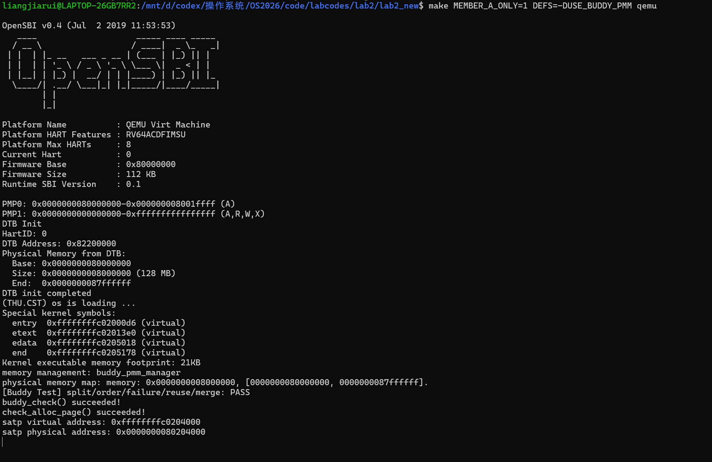

# 操作系统实验报告

## 实验基本信息

| 项目 | 内容 |
|------|------|
| **实验名称** | Lab 2：物理内存初始化与 Buddy System |
| **小组成员** | 2411046-梁家瑞、2412727-刘蔚霖、2411041-李培涛 |
| **完成日期** | 2026-10-16 |

### 小组分工

| 成员 | 负责的练习/模块 |
|------|----------------|
| 2411046-梁家瑞（成员 A） | `page_init()`、First-Fit 分析、Buddy System 及测试 |
| 2412727-刘蔚霖（成员 B） | Best-Fit 与 SLUB |
| 2411041-李培涛（成员 C） | 接口集成、构建验证、报告和交付检查 |

本报告只记录成员 A 的实现、分析和验证内容。完整小组分支仍需由成员 C 集成成员 B 的 Best-Fit、SLUB 以及最终测试结果。

---

## 一、实验目的

本实验研究内核如何发现、描述和分配物理内存。成员 A 的具体目标是：

1. 通过设备树得到物理内存范围，并建立 `Page` 描述符数组。
2. 排除 OpenSBI、内核镜像和描述符数组占用的页面，把剩余完整页面交给当前物理内存管理器。
3. 阅读 `default_pmm.c`，理解 First-Fit 的空闲链表、连续分配、释放和相邻块合并。
4. 在现有 `pmm_manager` 接口下实现 Buddy System，覆盖分裂、合并、不同阶次、释放复用和资源不足等行为。

## 二、实验环境

| 项目 | 内容 |
|------|------|
| 主机环境 | Windows + WSL Ubuntu（课程实验环境） |
| 目标架构 | RISC-V 64 |
| 编译器 | `riscv64-unknown-elf-gcc` |
| 模拟器 | `qemu-system-riscv64` |
| 代码目录 | `code/labcodes/lab2/lab2_new` |

成员 A 独立验证时使用 `MEMBER_A_ONLY=1` 排除尚待成员 B 完成的 `best_fit_pmm.c`；通过 `DEFS=-DUSE_BUDDY_PMM` 选择 Buddy System。该开关只用于分工阶段，完整小组版本仍由成员 C 集成全部分配器。

本成员使用 AI 的范围仅限于修改、润色实验报告结构。代码实现、测试设计和结果判断均依据课程代码、接口和本地验证进行。

## 三、实验整体逻辑分析

### 3.1 本章节的逻辑主线

Lab2 的主线是把“机器上的物理内存”逐步转换成“内核可以安全分配的页面资源”。启动页表已经让内核能够使用高地址的直接映射，因此 `pmm_init()` 首先选择一个物理内存管理器，然后 `page_init()` 读取设备树中的内存范围，建立 `Page` 描述符和物理页号之间的关系，保留已经被固件、内核和描述符数组占用的页面，最后通过 `init_memmap()` 注册空闲区。

之后，分配器通过统一的 `pmm_manager` 函数指针提供 `alloc_pages()`、`free_pages()` 和 `nr_free_pages()`。First-Fit 使用按地址排序的空闲区链表；Buddy System 把页面按二的幂次组织到不同阶次的链表中。二者虽然算法不同，但都遵守同一组页面状态约定，所以可以被同一个上层接口调用。

### 3.2 功能的逐步实现

1. `dtb_init()` 解析设备树并保存物理内存基址与大小，这是 `page_init()` 的输入。
2. `init_pmm_manager()` 初始化分配器的内部链表。成员 A 增加了 `USE_BUDDY_PMM` 开关，打开时选择 Buddy，默认路径仍保留原始管理器选择。
3. `page_init()` 设置地址转换偏移和 `npage`，把 `end` 之后的描述符数组按页对齐，并把所有描述符先标记为保留。
4. 计算描述符数组的物理末端后，向上对齐得到可用区起点；把设备树报告的内存末端向下对齐得到可用区终点；只有两者之间存在完整页面时才调用 `init_memmap()`。
5. First-Fit 作为参考算法说明基本的连续页面管理语义。Buddy System 在相同接口上增加阶次链表、分裂和伙伴合并。
6. `check_alloc_page()` 调用当前管理器的自检函数。Buddy 的自检保存空闲页总数，执行多种阶次分配和释放，再确认资源数恢复。

## 四、实验内容与实现

### 功能模块一：物理内存探测与 Page 描述符初始化

**负责人：** 2411046-梁家瑞

#### 模块功能描述

核心函数是 `kern/mm/pmm.c` 中的 `page_init()`。它连接设备树和物理页分配器，必须区分四种地址或编号：设备树给出的物理地址、内核使用的高半区虚拟地址、物理页号以及 `struct Page` 描述符地址。

关键接口为：

```c
static void page_init(void);
uint64_t get_memory_base(void);
uint64_t get_memory_size(void);
static void init_memmap(struct Page *base, size_t n);
static struct Page *pa2page(uintptr_t pa);
```

`page_init()` 的处理结果如下：

- `va_pa_offset` 设置为 `PHYSICAL_MEMORY_OFFSET`，使 `PADDR()` 能把内核虚拟地址转换为物理地址。
- `npage` 设置为设备树物理内存末端的页号，并限制在框架支持的物理内存上界内。
- `pages` 指向 `end` 之后按页对齐的描述符数组。
- `[DRAM_BASE, end)`、描述符数组所在页面以及对齐产生的占用页面保持 `PageReserved`。
- 描述符数组物理末端向上对齐到 `free_start`，设备树物理内存末端向下对齐到 `free_end`，只有 `[free_start, free_end)` 的完整页交给 `init_memmap()`。

这样做的关键是不能直接把虚拟地址 `pages` 当成物理地址使用。必须先使用 `PADDR()` 得到描述符数组的物理末端，再用 `pa2page()` 将空闲区物理起点转换成 Page 描述符指针。

#### 最终提示词

本成员没有使用 AI 生成或修改代码；本节的提示词只用于把已经完成的代码分析整理成报告结构，具体内容见 `report/prompt.md`。

#### 实现迭代过程

代码实现依据课程给出的接口和 `test_lab2.c` 的检查条件完成。重点检查了以下边界：设备树范围为零、地址加法溢出、物理内存末端超过框架上界、没有完整空闲页，以及描述符数组末端的页对齐。

**最终结果：**

- `page_init()` 设置了 `va_pa_offset`、`npage` 和 `pages`。
- 所有描述符在布局完成前先标记为保留。
- 内核末尾页和 Page 描述符数组页不会进入空闲区。
- 空闲区只包含完整页面，空区间不会错误调用 `init_memmap()`。

#### 本练习的 Spec 设计

本练习的规格先规定前置条件：设备树解析已经完成，`end` 是内核虚拟地址空间中的链接符号，物理内存管理器已经初始化。后置条件规定 `va_pa_offset`、`npage`、`pages` 和初始空闲区必须一致。规格再按设备树范围有效、范围无效、上界超过框架限制以及剩余空间不足一页四种情况分别描述结果。每一项都能由 `test_page_init()` 的状态检查或启动输出验证。

本练习没有使用 AI 编写代码的 prompt。`prompt.md` 中对应提示词只用于在实现完成后修改和润色报告结构，并明确不得修改源码、不得虚构测试结果。

#### 成员 A 对 page_init 练习问题的回答

设备树信息无效时，初始化不能继续，因为此时无法知道物理内存边界。实现通过 `panic()` 终止，避免把未知地址范围交给分配器。

`npage` 是可管理物理内存的页号上界，不是“空闲页数量”。`nbase` 是 `DRAM_BASE / PGSIZE`，因此 `pages[i]` 对应的物理页号是 `nbase + i`。这也是 `page2ppn()` 和 `pa2page()` 能够互相转换的原因。

Page 描述符数组自身占用物理内存。若不保留这部分页面，第一次分配就可能把分配器的元数据覆盖掉。内核镜像和 OpenSBI 同理，都必须排除在空闲区之外。

#### Challenge：OS 如何取得未知硬件的可用物理内存范围

OS 可以从固件或引导程序提供的硬件描述中取得内存布局。RISC-V 常用设备树 DTB 的 `memory` 节点；x86 可使用 BIOS E820 或 UEFI memory map；ACPI 也能描述部分硬件资源。引导程序需要把描述结构的地址作为启动参数传给内核。内核解析后还必须扣除固件、内核镜像、设备保留区、内存映射 I/O 和元数据所占范围。若平台完全没有提供描述接口，只能依赖平台约定或危险的探测读写；通用操作系统通常不会把破坏性探测作为首选。

### 功能模块二：First-Fit 连续物理内存分配原理

**负责人：** 2411046-梁家瑞

#### `default_init()`

`default_init()` 初始化 `free_area.free_list`，并把 `nr_free` 设为零。链表头是哨兵节点，不代表真实页面；真实空闲块的头页面通过 `page_link` 加入链表。

#### `default_init_memmap()`

这个函数接收一段连续的、此前标记为保留的页面。它逐页清除状态并清零引用计数，然后把 `base->property` 设为区间长度，在头页设置 `PG_property`。空闲链表按页面地址升序维护，`nr_free` 增加整个区间的页数。

#### `default_alloc_pages()`

函数从链表头向后扫描，遇到第一个 `property >= n` 的块就停止，这就是 First-Fit。若块比请求大，函数把剩余部分从 `page + n` 开始重新作为空闲块插回原位置；已分配头页清除 `PG_property`，`nr_free` 减少请求页数。若没有足够大的块则返回空指针。

#### `default_free_pages()`

释放时先清除每个页面的标志和引用计数，并把区间头设为新的空闲块。插入链表后，函数检查前驱块末尾是否正好等于当前块起点，再检查后继块起点是否正好等于当前块末尾。相邻块会被合并，从而减少外部碎片。

#### First-Fit 是否可以改进

可以。First-Fit 的优点是实现简单、搜索通常比 Best-Fit 快，且按地址排序的链表便于释放合并；缺点是每次分配都可能线性扫描链表，时间复杂度与空闲块数量有关，并且容易把低地址区域切割成许多小块。可改进方向包括：使用 Best-Fit 减少单次分配后的剩余碎片，使用 segregated free lists 按大小分组，或者使用 Buddy System 以按阶次搜索和快速伙伴定位换取内部碎片。改进需要权衡搜索开销、外部碎片、内部碎片和实现复杂度。

### 功能模块三：Buddy System 页面分配器

**负责人：** 2411046-梁家瑞

新增文件：

- `kern/mm/buddy_pmm.h`
- `kern/mm/buddy_pmm.c`
- `kern/mm/pmm.c` 中的管理器选择开关

主要接口为：

```c
static void buddy_init(void);
static void buddy_init_memmap(struct Page *base, size_t n);
static struct Page *buddy_alloc_pages(size_t n);
static void buddy_free_pages(struct Page *base, size_t n);
static size_t buddy_nr_free_pages(void);
static void buddy_check(void);
const struct pmm_manager buddy_pmm_manager;
```

#### 数据结构和阶次

`free_lists[order]` 保存第 `order` 阶的空闲块。一个 `order` 阶块包含 `2^order` 个页面。由于课程默认 QEMU 的内存为 128 MiB，即 32768 个页面，模块使用 0 到 15 阶，足以覆盖整个默认内存范围。

空闲块头页的 `property` 保存阶次并设置 `PG_property`。分配后的头页把阶次保存为 `order + 1`，这样即使是 0 阶也能在 `free_pages()` 中区分“未记录”和“0 阶分配”。页面分配接口仍然是统一的 `pmm_manager` 接口。

#### `buddy_init_memmap()`

初始化时先清理整个输入区间的描述符状态，再把不一定按最大块边界开始的区间分解为多个对齐的二的幂次块。分解过程从区间起点开始，每次选择不超过剩余长度且满足当前相对偏移对齐条件的最大块，加入对应阶次的空闲链表。这样可以处理 `page_init()` 产生的任意起点和长度。

#### `buddy_alloc_pages()`

请求 `n` 页时先计算满足 `2^order >= n` 的最小阶次。从目标阶次向更高阶搜索第一个非空链表。找到更大块后，将它从空闲链表取下，重复分裂：每次保留左半块继续分裂，把右半块加入低一阶空闲链表。最后清理返回块的页面状态，保存实际阶次并减少 `buddy_nr_free`。

#### `buddy_free_pages()`

释放时从分配头页的 `property` 恢复实际阶次，并按实际块大小恢复空闲页数。随后以管理区间内的相对页号异或计算伙伴位置：`buddy_index = index ^ (1 << order)`。若伙伴在管理区间内、设置了 `PG_property` 且阶次相同，就从伙伴链表移除并合并为更高阶块；重复该过程直到伙伴不存在、阶次达到上限或边界阻止合并。

#### 测试覆盖

`buddy_check()` 保存初始空闲页数，然后分配 1 页、3 页和 8 页。它们分别触发 0 阶、2 阶和 3 阶请求，能够覆盖向上取整与分裂。随后先释放中间块，再释放其他块，覆盖伙伴合并和不同释放顺序；还请求超过全部空闲页的数量，覆盖失败路径，并确认最终空闲页数量恢复到初值。

Buddy System 的边界是：请求为零由接口断言拒绝；请求超过可表示阶次或当前空闲页数时返回空指针；释放块必须来自当前管理区间，且不能释放保留页；合并必须检查伙伴边界，不能访问区间外的 `Page` 描述符。

#### 本练习的 Spec 设计

Buddy 实现规格以前置条件“输入区间由连续、保留的 `Page` 描述符组成”为基础，后置条件要求每个空闲页恰好属于一个阶次链表、空闲页计数等于各空闲块页数之和。分配规格按目标阶已有块、需要分裂高阶块、空间不足三种情况描述；释放规格按伙伴不可合并、一次合并和连续向上合并描述。测试规格则把这些状态映射成 3 页向上取整为 4 页、4+4 合并为 8、8+8 合并为 16、耗尽后返回空指针以及释放后重新分配 16 页等断言。

本练习没有使用 AI 生成 Buddy 代码或测试。`prompt.md` 分别保留 Buddy 实现说明和测试说明的报告结构润色提示词，二者都禁止修改源码或补造结果。

## 五、测试与验证

以下两张图片记录了成员 A 已完成的实际验证结果，图片文件位于 `report/images/`。

### 5.1 page_init 构建与运行结果

该结果显示内核能够读取设备树中的物理内存范围，完成 `page_init()`，并通过页面分配器自检。



### 5.2 Buddy System 自检结果

该结果显示 Buddy System 已完成阶次分裂、空间不足处理、释放复用和伙伴合并测试。



### 5.3 完整小组 grade 结果

成员 B 完成 Best-Fit 并完成小组集成后补充此图片。


验证时应区分默认路径和 Buddy 路径：默认路径供成员 C 集成 Best-Fit；Buddy 路径通过 `USE_BUDDY_PMM` 选择 `buddy_pmm_manager`，并由 `buddy_check()` 验证页面分裂、合并、复用和失败。

## 六、实验总结与收获

### 对操作系统的理解

| 实验知识点 | OS 原理对应概念 | 关系与差异 |
|------------|----------------|------------|
| Page 描述符 | 页框管理与物理内存元数据 | 实验用一个 `struct Page` 描述一个物理页；原理上还可扩展引用计数、脏位、换出状态等字段 |
| `va_pa_offset`、`PADDR`、`pa2page` | 地址空间与地址转换 | 实验使用内核线性映射完成简单转换；完整操作系统还需要进程页表和权限检查 |
| First-Fit | 连续内存分配 | 按链表顺序找第一个可用块，实现简单但可能产生外部碎片 |
| Buddy System | 伙伴系统分配 | 通过二进制阶次快速分裂与合并，减少外部碎片和搜索成本，但可能产生内部碎片 |
| `pmm_manager` | 内核抽象接口和策略替换 | 函数指针把分配策略与上层调用解耦，便于替换算法 |
| `PageReserved`、`PageProperty` | 资源状态与不变量 | 标志位保证保留页不被分配、空闲块头能被定位；它们是本实现的状态不变量 |

本实验没有覆盖但在 OS 原理中很重要的知识包括：基于进程的独立虚拟地址空间、缺页异常和按需分配、页面置换算法、写时复制、交换区、NUMA 内存管理、内存回收与并发锁。这些机制建立在本实验的物理页管理之上，但需要进程、异常、文件或并发实验继续提供支持。

### AI 协作开发的经验

本成员仅使用 AI 修改、润色报告结构，没有让 AI 生成或修改实验代码。因此不存在“AI 生成代码后编译失败”的实际问题。代码中的判断均回到 `pmm.h`、`memlayout.h`、`default_pmm.c`、课程测试条件和实际构建输出进行核对；报告中的 AI 说明也只保留报告结构润色这一范围。
