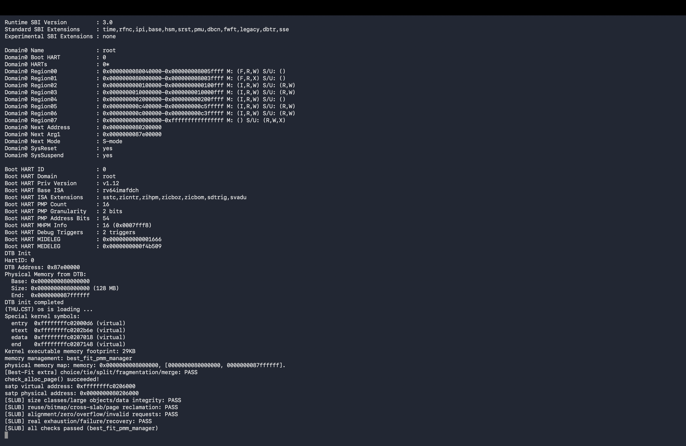
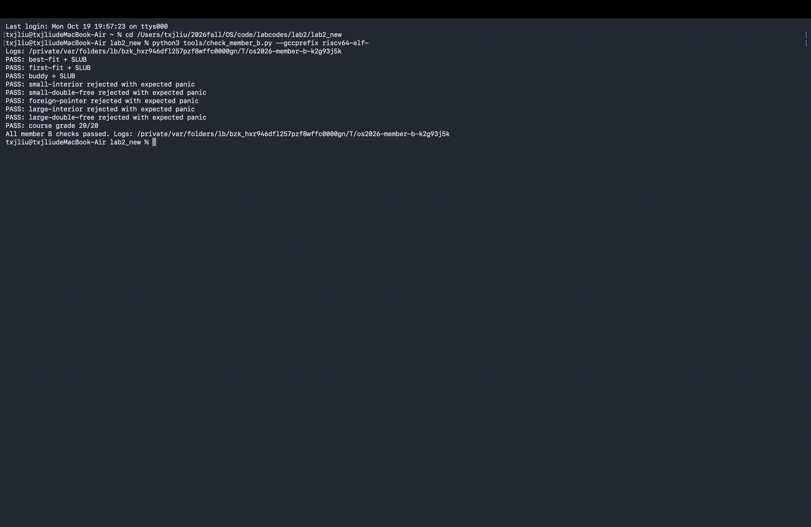
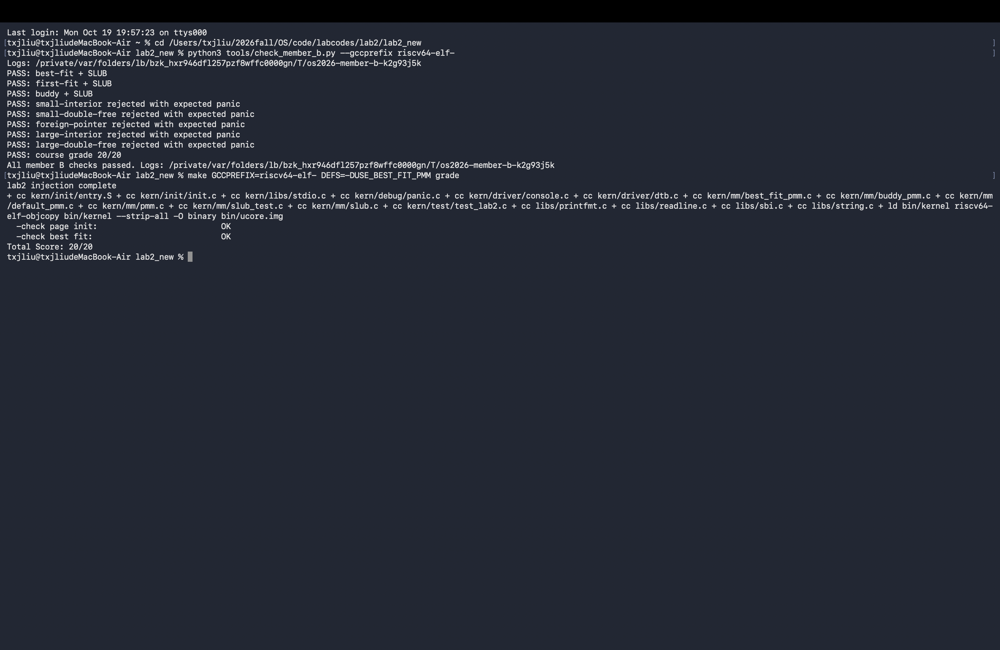

# Lab2 成员 B：Best-Fit 与 SLUB

完成日期：2026-10-19。本文记录成员 B 的实现和本机实际验证，供成员 C 汇总。成员 B 的协作记录见 [promptB.md](./promptB.md)。

## 1. 实现范围

- Best-Fit 连续页分配器及管理器选择已经完成；本次补充最小适配、同尺寸选择、分裂、碎片失败和前后合并测试。
- SLUB 小对象使用 16、32、64、128、256、512、1024、2048 字节八种 cache。
- 超过小对象规格的请求使用连续多页分配，不再限制为 64 字节。
- `kmalloc()` 默认保证 16 字节对齐；`kmalloc_aligned()` 接受不超过一页的二次幂对齐要求，小于 16 时按 16 处理。
- 支持释放复用、空 slab 页面回收、溢出检查、空间不足返回 `NULL`，以及非法或重复释放触发 `panic`。
- SLUB 分配器、自检和自动化运行脚本分别组织，测试可在 First-Fit、Best-Fit 和 Buddy 后端运行。

## 2. 文件与接口

| 文件 | 作用 |
|---|---|
| `kern/mm/best_fit_pmm.c` | Best-Fit 实现和新增的独立描述符测试 |
| `kern/mm/slub.c` | cache、slab、空闲对象链表、位图、多页大对象 |
| `kern/mm/slub.h` | 公开对象分配接口和使用约定 |
| `kern/mm/slub_test.c` | 正常路径、真实耗尽与预期 panic 测试 |
| `kern/init/init.c` | `pmm_init()` 后调用 `slub_init()`、`slub_check()` |
| `tools/check_member_b.py` | 自动切换后端、重建、启动 QEMU、检查输出并保存日志 |
| `kern/mm/default_pmm.c` | 修复两处尾部插入后缺少 `break` 的问题 |

```c
void slub_init(void);
void *kmalloc(size_t size);
void *kmalloc_aligned(size_t size, size_t alignment);
void kfree(void *ptr);
void slub_check(void);
```

页级后端保持统一的 `alloc_pages()`、`free_pages()`、`nr_free_pages()` 接口。调用者必须先完成物理内存初始化，再初始化 SLUB。重复调用 `slub_init()` 不会丢失现有分配。

## 3. Best-Fit 原理和附加测试

空闲块按地址排序，块头的 `property` 保存连续空闲页数量，`nr_free` 保存所有空闲页总数。分配遍历链表，选择满足请求的最小块；同尺寸候选保持地址较低者。块过大时把剩余部分重新插入空闲链表。释放后检查前驱和后继，合并相邻空闲块。

本次附加测试使用栈上的 40 个 `Page` 描述符，暂存真实 `free_area`，完成测试后恢复。它不访问这些测试描述符对应的物理页，也不会消耗真实空闲页。原有 `basic_check()`、`best_fit_check()` 函数体保持不变，由包装检查函数依次调用原检查和附加检查。

附加场景包括：

1. 构造 3、5、8、5 页四个不相邻空闲块。
2. 请求 4 页时选择地址较低的 5 页块，并留下 1 页余量。
3. 验证精确匹配以及同尺寸候选的确定性选择。
4. 验证总空闲页足够但连续块不足时返回 `NULL`，且计数不变。
5. 分别验证仅向前合并、仅向后合并和同时连接前后块。
6. 检查链表双向链接、地址顺序、相邻块合并状态与空闲页计数。

## 4. SLUB 组织与分配流程

每个 cache 保存完整 slab 链表和 `partial` 链表。`partial` 只包含还有空闲对象的 slab，因此通常可直接从链表头取对象。slab 的管理信息放在后端页面开头，随后按 cache 规格对齐，剩余空间切成固定大小对象。

`Page *` 是描述符地址，不能当作分配页面的存储地址。本实现通过 `page2pa(page) + va_pa_offset` 转换为内核虚拟地址，再放置 slab 元数据。

每个空闲对象开头保存下一个空闲对象指针。分配后对象内容交给调用者使用，分配器使用独立位图记录分配状态。位图有四个 64 位字，足以覆盖单页最小对象规格的所有槽位；对象编号通过 `index / 64` 和 `index % 64` 定位位图。

小对象分配过程：

1. 校验大小与对齐参数。
2. 选择同时满足大小、对齐要求的最小 cache。
3. 优先使用该 cache 的 `partial` slab；不存在时申请一页并建立新 slab。
4. 从对象空闲链表取出一个槽位，置位位图，增加 `inuse`。
5. slab 满时从 `partial` 链表摘除。

大对象先检查元数据、对齐填充、用户大小和页对齐计算是否溢出，再计算所需页数。每个大对象使用独立 slab 记录原请求页数，释放时交回页级后端。Buddy 会从页面描述符恢复实际阶次，因此即使它向上取整了页数，也能正确回收。

## 5. 释放与错误处理

`kfree()` 遍历受管理的 slab，验证传入地址是对象起始地址，并检查位图，随后清位、递减计数、放回空闲链表。原来满的 slab 重新进入 `partial` 链表；完全空闲时先摘除管理链表，再归还页面。页面归还后不再读取其中的元数据。

- `kmalloc(0)`、无效对齐、大小计算溢出和无法取得连续页面时返回 `NULL`。
- `kfree(NULL)` 不改变分配状态。
- 对象内部地址、未受管理的地址和重复释放触发 `panic`。
- 大对象释放只接受原始返回地址，不接受中间页的地址。

与其他普通内存分配器一样，若一个已释放地址随后被重新用于新对象，仅凭地址不能区分旧指针和新指针；调用者仍需遵守对象生命周期。

## 6. 测试环境与复现

本次实际环境为 macOS、`riscv64-elf-gcc 16.2.0`、`QEMU 11.1.2`、QEMU 默认的 OpenSBI 1.8.1，目标为 RISC-V 64，默认物理内存 128 MiB。

在 `code/labcodes/lab2/lab2_new` 目录运行：

```sh
python3 tools/check_member_b.py --gccprefix riscv64-elf-
```

脚本不传 `--gccprefix` 时会尝试发现 `riscv64-unknown-elf-` 和 `riscv64-elf-` 工具链。每个配置都会先清理再编译，因为原 Makefile 不跟踪 `DEFS` 参数变化。QEMU 运行有时间上限，达到预期输出后主动结束；日志存入脚本打印的临时目录。

只运行默认的 Best-Fit 版本：

```sh
make clean
make GCCPREFIX=riscv64-elf- DEFS=-DUSE_BEST_FIT_PMM qemu
```

### 实际通过的测试

| 测试组 | 内容 | 结果 |
|---|---|---|
| Best-Fit + SLUB | 原有页分配检查、Best-Fit 附加检查、完整 SLUB 自检 | PASS |
| First-Fit + SLUB | 相同 SLUB 自检，使用 First-Fit 页后端 | PASS |
| Buddy + SLUB | Buddy 原有自检、相同 SLUB 自检 | PASS |
| 小对象内部地址 | 单独启动，调用 `kfree(ptr + 1)` | 预期 panic |
| 小对象重复释放 | 保留同 slab 另一个对象，连续释放同一地址 | 预期 panic |
| 外来地址 | 尝试释放栈上变量 | 预期 panic |
| 大对象内部页 | 尝试释放 `ptr + PGSIZE` | 预期 panic |
| 大对象重复释放 | 归还大对象后再次释放同一地址 | 预期 panic |
| 课程评分 | `make GCCPREFIX=riscv64-elf- DEFS=-DUSE_BEST_FIT_PMM grade` | 20/20 |

### 真实终端截图

以下三张图片均由成员 B 在本机终端实际运行后截取，按原图保存。

**Best-Fit 与 SLUB 内核运行结果。** 图中展示 OpenSBI 跳转地址、128 MiB 物理内存信息、Best-Fit 附加检查，以及 SLUB 多规格、大对象、复用、对齐和真实耗尽恢复检查全部通过。



**完整验证汇总。** 图中包含执行自动验证脚本的命令、三种页级后端通过、五种非法释放被预期 panic 拦截、课程评分 20/20，以及脚本最终完成标志。这里的预期 panic 是错误路径验证成功。



**课程评分结果。** 图中展示单独执行 `make grade` 的命令、物理内存初始化与 Best-Fit 两项检查均为 `OK`，总分为 20/20。



### 自检覆盖范围

完整 SLUB 自检覆盖：

- 30 种请求大小，跨越全部 cache 边界，包括 2049、4096、4097、8193、65537 字节。
- 多对象地址不重叠、逐字节数据完整性、释放后复用。
- 257 个 16 字节对象跨 slab，验证位图编号超过 63 的分配和释放。
- 1～4096 范围内所有二次幂对齐；分别检查小对象与多页大对象。
- 零大小、无效对齐、极大请求和算术溢出。
- 真实耗尽所有剩余物理页；新 cache 和大对象分配失败，但已有 partial slab 仍可分配。
- 释放全部暂存页后再次分配大对象，并确认空闲页总数恢复。

课程 `grade` 主要验证物理内存初始化和 Best-Fit。SLUB 的结论来自独立自检与单独启动的错误路径测试，不能用课程 20/20 代替这些检查。

## 7. 联调中发现的问题

First-Fit 参考实现的 `default_init_memmap()` 和 `default_free_pages()` 在尾部插入后未退出循环，导致新节点再次参与插入，破坏 `prev` 链接。真实耗尽后归还页面的测试暴露了这一问题。本次分别增加一个 `break`；原有 First-Fit 检查函数体未修改。修复后 First-Fit 后端通过完整测试。

此前阶段已修复 QEMU 的内核启动参数和开启 Sv39 时缺少低地址恒等映射的问题。本次沿用这些启动修复。

## 8. 使用边界与协作说明

这是单核教学实现，未提供多核同步、NUMA、每 CPU cache、后台回收等生产内核机制。查找待释放对象所属 slab 使用链表遍历，时间与 slab 数量相关。大对象依赖连续物理页，可能在总空闲内存仍足够时因碎片而分配失败。
