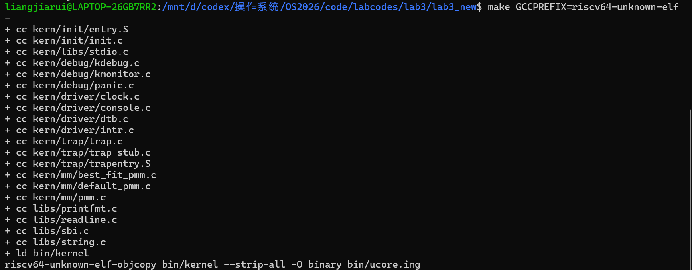

# 操作系统实验报告

## 实验基本信息

| 项目 | 内容 |
|------|------|
| 实验名称 | Lab 3：中断与异常处理——成员 A：Trap 上下文恢复与 Trap 入口 |
| 小组成员 | 2411046-梁家瑞、2412727-刘蔚霖、2411041-李培涛 |
| 本人负责 | 2411046-梁家瑞：kern/trap/trapentry.S 中的 RESTORE_ALL、__alltraps |
| 完成日期 | 2026-10-27 |

### 小组分工

| 成员 | 负责的练习/模块 |
|------|----------------|
| 2411046-梁家瑞 | Trap 上下文恢复与 Trap 入口：RESTORE_ALL、__alltraps |
| 2412727-刘蔚霖 | 中断与异常处理：interrupt_handler()、exception_handler() |
| 2411041-李培涛 | lab2 迁移、框架集成、构建验证和交付检查 |

本报告只详细记录成员 A 的实现、理解和验证方法。成员 B 的 C 语言中断/异常处理代码以及成员 C 的最终联调结果，待小组汇合后补入总报告。

---

## 一、实验目的

1. 理解 RISC-V 中 Trap、异常、中断、stvec、sscratch、scause、sepc、stval、sstatus 和 sret 的作用。
2. 根据已有的 SAVE_ALL 和 struct trapframe 布局，实现严格对应的 RESTORE_ALL。
3. 实现 __alltraps，把汇编入口保存的 TrapFrame 按 RISC-V 调用约定传给 C 函数 trap(struct trapframe *tf)。
4. 形成“Trap 发生—保存上下文—C 语言处理—恢复上下文—sret 返回”的闭环。
5. 通过寄存器上下文测试和断点异常测试，验证恢复代码没有遗漏寄存器、没有破坏栈指针。

---

## 二、实验环境

- 工程：OS2026
- 实验目录：code/labcodes/lab3/lab3_new
- 目标架构：RISC-V 64
- 编译器前缀：riscv64-unknown-elf-
- 模拟器：QEMU 4.1.1
- 负责学号：2411046

成员 A 的改动集中在：

~~~text
code/labcodes/lab3/lab3_new/kern/trap/trapentry.S
~~~

实验报告中的图片位置先保留为空位，实际截图由运行环境产生后放入 report/images/。

---

## 三、实验整体逻辑分析

### 3.1 本章节的逻辑主线

Lab3 在 Lab2 的物理内存初始化和页表基础上，让内核能够响应异步中断和同步异常。RISC-V 把中断和异常统一称为 Trap：中断是异步事件，例如时钟中断；异常是同步事件，例如非法指令和 ebreak。

处理 Trap 不能只跳转到一个 C 函数。处理器必须保存被打断代码的执行现场，否则返回时寄存器、栈和控制状态会被破坏。因此本实验分成三个层次：

1. SAVE_ALL 把寄存器和关键 CSR 保存成内存中的 struct trapframe；
2. __alltraps 把这个 TrapFrame 传给 C 层的 trap()；
3. RESTORE_ALL 从同一份 TrapFrame 恢复现场，最后用 sret 返回原执行流。

成员 A 负责汇编入口和恢复代码。成员 B 负责 C 层对中断/异常原因的分类和具体处理。两部分必须使用完全一致的 TrapFrame 布局。

### 3.2 完整执行顺序

内核启动主线：

~~~text
entry.S -> kern_init() -> idt_init()
        -> stvec = __alltraps
        -> clock_init() -> intr_enable()
~~~

一次 Trap 的处理主线：

~~~text
硬件写入 scause/sepc/stval/sstatus
  -> __alltraps
  -> SAVE_ALL
  -> a0 = sp（当前 TrapFrame 地址）
  -> jal trap
  -> trap_dispatch()
  -> interrupt_handler() 或 exception_handler()
  -> __trapret
  -> RESTORE_ALL
  -> sret
~~~

SAVE_ALL 与 RESTORE_ALL 必须严格对称。任何偏移量错误都会导致恢复出的寄存器来自其他字段，最终表现为返回地址、栈指针或函数参数损坏。

---

## 四、实验内容与实现

### 4.1 TrapFrame 的内存布局

trap.h 中的 struct trapframe 先放置 32 个通用寄存器，再放置 4 个 CSR：

~~~c
struct trapframe {
    struct pushregs gpr;  // x0 ~ x31
    uintptr_t status;     // sstatus
    uintptr_t epc;        // sepc
    uintptr_t badvaddr;   // stval
    uintptr_t cause;      // scause
};
~~~

在 64 位 RISC-V 中，REGBYTES 为 8，各字段偏移为：

| TrapFrame 下标 | 内容 | 作用 |
|---:|---|---|
| 0 | x0 | 常量 0，恢复时不需要写入 |
| 1 | x1/ra | 返回地址 |
| 2 | x2/sp | Trap 发生前的栈指针 |
| 3~31 | 其他通用寄存器 | 被打断程序的寄存器现场 |
| 32 | sstatus | 特权级和中断状态 |
| 33 | sepc | Trap 返回地址 |
| 34 | stval | 异常附加信息 |
| 35 | scause | Trap 原因 |

SAVE_ALL 先执行 csrw sscratch, sp 保存原始栈指针，再把 sp 减去 36 * REGBYTES。因此保存后的 sp 指向 TrapFrame 起始地址；原始 sp 通过 sscratch 读出后存入第 2 项。这就是 x2/sp 不能和其他寄存器完全一样处理的原因。

### 4.2 RESTORE_ALL

负责人：2411046-梁家瑞

核心约束：

- 不修改已有的 SAVE_ALL；
- 按原偏移恢复 sstatus、sepc、stval、scause；
- 恢复 x1 和 x3~x31；
- 最后从第 2 项恢复 sp；
- 不恢复 x0，因为 x0 硬连线为 0；
- 恢复 sp 后不再访问 TrapFrame。

实现使用 t0 作为恢复 CSR 时的临时寄存器：

~~~asm
LOAD t0, 32*REGBYTES(sp)
csrw sstatus, t0
LOAD t0, 33*REGBYTES(sp)
csrw sepc, t0
LOAD t0, 34*REGBYTES(sp)
csrw stval, t0
LOAD t0, 35*REGBYTES(sp)
csrw scause, t0
~~~

此时 t0 的原值暂时被覆盖，但之后会执行 LOAD x5, 5*REGBYTES(sp)，所以 t0 最终恢复正确。随后按保存布局恢复其余寄存器，sp 必须最后恢复：

~~~asm
LOAD x31, 31*REGBYTES(sp)
LOAD sp, 2*REGBYTES(sp)
~~~

如果提前恢复 sp，后续 LOAD offset(sp) 会从 Trap 发生前的栈读取，无法继续访问当前 TrapFrame。

### 4.3 __alltraps

__alltraps 是 stvec 指向的统一 Trap 入口。SAVE_ALL 执行后，sp 指向当前 TrapFrame。根据 RISC-V ABI，第一个 C 函数参数放入 a0：

~~~asm
mv a0, sp
jal trap
~~~

trap() 返回后，程序顺序落到 __trapret，执行 RESTORE_ALL 和 sret。__alltraps 不重新分配栈，也不改变 TrapFrame 地址。jal trap 修改的 ra 只是 Trap 处理过程中的调用返回地址，原始 ra 已保存到 TrapFrame，并会在 RESTORE_ALL 中恢复。

### 4.4 与其他模块的接口关系

- trap.c 的 idt_init() 把 __alltraps 地址写入 stvec；
- trap() 接收 a0 传入的 struct trapframe *；
- 成员 B 的 trap_dispatch() 根据 scause 最高位区分中断和异常；
- 成员 B 在处理断点或非法指令后修改 tf->epc；
- RESTORE_ALL 从修改后的 TrapFrame 恢复 sepc；
- sret 根据 sepc 和 sstatus 返回。

RESTORE_ALL 不判断异常类型，也不自行修改 epc；汇编层只负责忠实恢复 TrapFrame 当前记录的状态。

---

## 五、Spec、Prompt、迭代与问题分析

### 5.1 本模块 Spec

Pre-Condition：

- SAVE_ALL 已经存在并能构造完整 TrapFrame；
- struct trapframe 布局保持不变；
- trap(struct trapframe *tf) 签名保持不变；
- LOAD、STORE、REGBYTES 等宏由 riscv.h 提供；
- stvec 已经指向 __alltraps。

Post-Condition：

- 每个 Trap 进入 __alltraps 后，都能把 TrapFrame 地址作为 a0 传给 trap()；
- trap() 返回后能执行 RESTORE_ALL；
- 四个 CSR 和所有可变通用寄存器恢复为 Trap 发生前或 C 层修改后的值；
- sp 恢复为 Trap 发生前的值；
- sret 从正确的 sepc 返回。

约束：

- 不修改 SAVE_ALL、struct trapframe 和 trap()；
- 不遗漏 x1、x3~x31；
- 不把 TrapFrame 的第 2 项误当成当前 Trap 栈顶；
- 不在恢复原始 sp 后继续访问 TrapFrame；
- 不把 C 层异常处理逻辑写入汇编入口。

测试 Case：

1. 触发 ebreak，验证 __alltraps -> trap -> __trapret -> sret 闭环；
2. 触发 Trap 前给临时寄存器、保存寄存器和参数寄存器设置不同值，返回后逐项比较；
3. 检查 sp 恢复后能继续执行后续指令；
4. 检查 sepc 使用 C 层更新后的值，避免再次触发同一异常；
5. 用 GDB 在 __alltraps 和 __trapret 观察 sp、a0 和 TrapFrame 字段。

### 5.2 本次 AI 协作范围

按照本实验的提交约束，AI 只用于阅读实验要求、梳理报告结构和润色文字；成员 A 的汇编代码由本人依据 SAVE_ALL、trapframe 布局和 RISC-V ABI 编写并逐项核对。因此没有“AI 直接生成代码后出现 bug”的记录，代码问题通过汇编布局检查和测试用例定位。

报告结构整理提示词见 report/prompt.md。该提示词只要求 AI 帮助组织实验报告，不要求 AI 生成或修改实验代码。

### 5.3 实现中的关键风险与处理

风险 1：误把第 2 项当作普通寄存器恢复。SAVE_ALL 保存的第 2 项是 Trap 前的原始 sp。处理方式是保留 sp 指向 TrapFrame，先恢复其余字段，最后执行 LOAD sp, 2*REGBYTES(sp)。

风险 2：恢复 CSR 时破坏 t0。CSR 不能直接从内存写入，必须先加载到通用寄存器。实现使用 t0 暂存，但随后重新加载 x5/t0，所以最终上下文不被破坏。

风险 3：__alltraps 没有传递参数。只调用 jal trap 而不设置 a0，会让 C 函数把未定义值当作 TrapFrame 指针。实现显式执行 mv a0, sp。

风险 4：使用旧 CSR 名称。实验框架的 SAVE_ALL 使用 stval 保存异常附加值，因此 RESTORE_ALL 对应使用 csrw stval, t0。

---

## 六、测试与验证

### 6.1 成员 A 应完成的验证

| 验证项目 | 预期现象 |
|---|---|
| 汇编编译 | trapentry.S 能通过 RISC-V 交叉编译 |
| TrapFrame 入口 | 在 __alltraps 断点处，a0 == sp，且 sp 指向 TrapFrame |
| 上下文恢复 | ebreak 前写入的寄存器值返回后全部保持不变 |
| 栈恢复 | 返回后 sp 等于 Trap 发生前的栈指针 |
| 异常返回 | sepc 指向处理器更新后的继续执行地址，不重复触发同一异常 |

### 6.2 图片占位

第一张截图显示实验目录中的构建已经完成：trapentry.S 等源文件成功编译，内核成功链接，并通过 objcopy 生成 bin/ucore.img。这证明当前成员 A 的汇编文件能够通过工具链的编译和链接阶段。

以上位置只保留图片引用，不在报告中写截图命令。截图完成后，把图片按文件名放入 report/images/。

### 6.3 当前验证边界

成员 A 的代码已经完成静态布局核对，构建结果已有第一张截图作为证据。GDB 上下文观察、断点异常闭环和最终 make grade 仍需在成员 B 完成 trap.c 后进行全组联调；后两张图片位置暂时保留为空。没有实际终端证据的结果不在本报告中写成“通过”。

---

## 七、重要知识点与 OS 原理对应

| 实验知识点 | OS 原理含义 | 本实验体现 |
|---|---|---|
| Trap | 控制权从当前流转入特权处理代码的统一机制 | 中断和异常都进入 __alltraps |
| 上下文 | 程序继续执行所需的寄存器和控制状态 | trapframe 保存 32 个 GPR 和 4 个 CSR |
| 中断与异常 | 中断异步，异常同步 | 时钟中断与 ebreak/非法指令分别验证 |
| stvec | S 模式 Trap 入口地址寄存器 | idt_init() 设置为 __alltraps |
| scause | 记录 Trap 原因和中断标志 | C 层据此分发处理 |
| sepc | 记录 Trap 发生时的程序计数器 | sret 从恢复后的地址继续 |
| sstatus | 保存特权级和中断状态 | Trap 返回时恢复原状态 |
| sret | 从 S 模式返回被打断特权级 | 完成 Trap 闭环 |
| 调用约定 | 规定函数参数和返回值寄存器 | a0 传递 TrapFrame 指针 |

实验代码是对原理的最小化实现：真实操作系统还会考虑多核并发、嵌套 Trap、用户/内核双栈、延迟处理、中断屏蔽和更复杂的异常恢复。本实验重点是建立保存、处理、恢复和返回的基本闭环。

### OS 原理中本实验没有直接覆盖的内容

1. 多核系统中的每 CPU Trap 栈和中断亲和性；
2. 外部设备中断控制器、MSI/MSI-X 和中断路由；
3. 完整的系统调用入口、用户地址检查和权限隔离；
4. 缺页异常与按需分页；
5. 中断线程化、软中断和底半部机制；
6. 嵌套中断、优先级和实时调度；
7. 信号、进程级异常和调试器断点的完整实现。

---

## 八、实验总结

成员 A 的核心工作不是单独写几条 LOAD 指令，而是保证三个约束同时成立：保存布局不变、C 函数调用约定正确、恢复顺序不会破坏当前栈。最容易出错的地方是 sp 的特殊保存方式和 CSR 的恢复顺序。完成后，Trap 的汇编层成为一个稳定的包装器：它把处理器现场转换成 C 可以理解的结构体，C 层处理完成后再把结构体还原成处理器现场。

本模块最终能否在 QEMU 中通过，必须以实际工具链构建、GDB 检查和小组联调输出为准。成员 B 完成异常处理后，重点复核 tf->epc 修改是否会被 RESTORE_ALL 正确写回 sepc。
