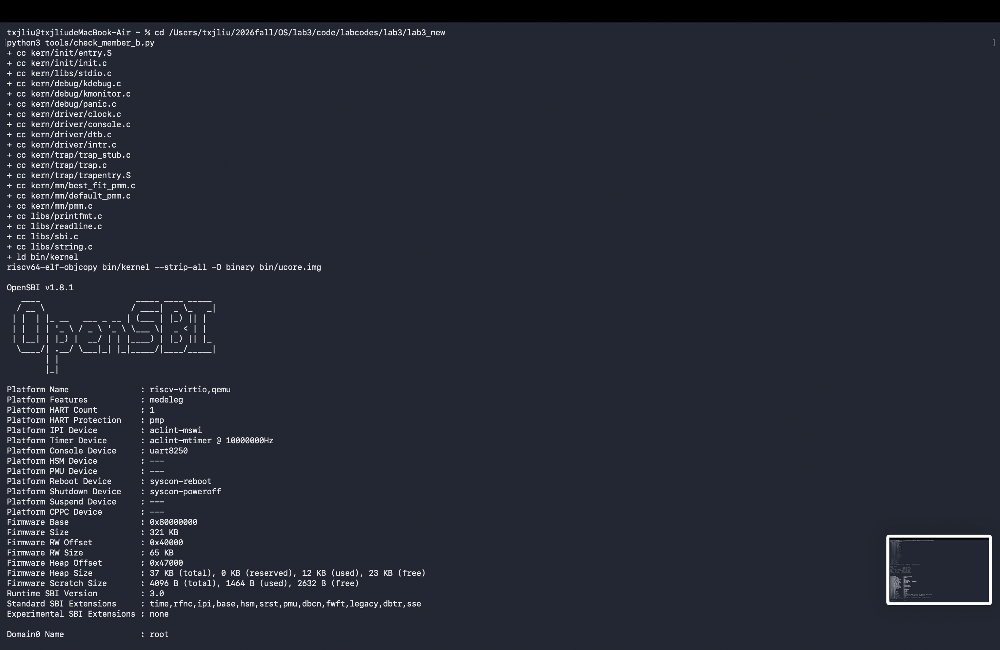
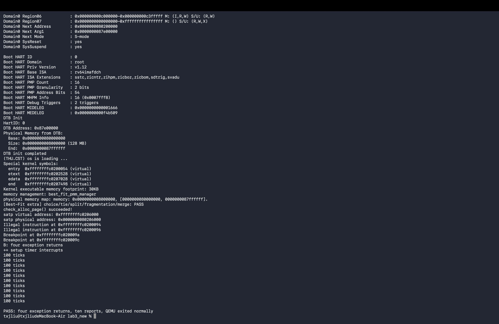

# Lab3 成员 B · 2412727 刘蔚霖

## 实现与接口

基于框架迁移 a70e615 和 A 的 2081fae。硬件把原因和返回 PC 写入 scause、sepc，A 的入口保存现场，trap_dispatch 按原因最高位选择处理函数。B 更新栈上的 TrapFrame 后，A 的恢复代码把 epc 写回 sepc，sret 继续执行。[模块源码](../code/labcodes/lab3/lab3_new/kern/trap/trap.c) · [成员 B 报告提示词](prompt.md#prompt-b中断与异常处理)

- **时钟**。IRQ_S_TIMER 先设置下一次事件，再递增 ticks。每 100 次沿用 print_ticks 的格式。练习规定按累计输出次数关机，源码只有 TICK_NUM，未定义 SHUTDOWN_AFTER，本次默认取 10，可通过编译宏覆盖。第 1000 次中断输出后调用 sbi_shutdown。其他已知中断按类型提示，未知中断打印原因与完整现场。
- **同步异常**。非法指令与断点分别输出评分脚本匹配的消息和原 PC。只读取故障地址的首个半字，低两位为 11 时跳过 4 字节，否则跳过 2 字节。异步时钟不能跳过被打断的指令。其余异常只打印现场。
- **原理边界**。时钟重设支撑周期性调度，本实验只计数。跳过异常指令用于内核自测，尚未涉及用户进程信号、缺页恢复或调度器。Challenge 的特权态切换由小组另行决定。

## 验收与复现

在 lab3 仓库根目录执行。测试工具把源文件复制到临时目录，注入四条相邻指令，同时适配下面记录的本机启动问题。它检查四条异常的类型、地址差、返回标志、统计次数和 QEMU 退出码。

```sh
cd code/labcodes/lab3/lab3_new
make clean && make GCCPREFIX=riscv64-elf-
python3 tools/check_member_b.py
```

本机 GCC 16.2.0、QEMU 11.1.2。干净构建通过。在只适配启动环境的副本中，普通内核输出十次 `100 ticks` 并正常退出。加入异常测试后，实测输出节选如下。

```text
Illegal instruction at 0xffffffffc0200094
Illegal instruction at 0xffffffffc0200096
Breakpoint at 0xffffffffc020009a
Breakpoint at 0xffffffffc020009c
B: four exception returns
++ setup timer interrupts
```

依次执行 0x0000、0x0000007b、0x9002、0x00100073。前三个 PC 差分别为 2、4、2；最后一个 32 位断点后成功执行标志打印，四条指令各触发一次。之后十次统计，QEMU 自行退出。[复现脚本](../code/labcodes/lab3/lab3_new/tools/check_member_b.py)



图 1　运行 python3 tools/check_member_b.py，编译并链接内核，生成镜像后启动 OpenSBI。



图 2　两条非法指令和两条断点指令各触发一次，随后内核打印 four exception returns。时钟累计输出十行 100 ticks，复验脚本确认 QEMU 正常退出。

## 联调记录与交接

基线能链接，原因是 trap_stub.c 提供弱定义。原始 make qemu 的 OpenSBI 下一跳为零。显式加载内核后下一跳为 0x80200000，但启动页表只有高地址映射，启用 satp 后仍须在低地址取指。临时副本在根页表第 2 项加入物理 0x80000000 起始的恒等映射，并为 QEMU 增加 `-kernel bin/ucore.img`。课程 make grade 在同样适配的临时副本运行，使用本机超时命令替代工具，评分逻辑和匹配条件沿用原脚本。上下文恢复 35/35，非法指令与兜底 25/25，持续时钟 40/40。这是适配环境的成绩；C 仍需确认默认启动方式与关机次数。未发现需要返工的 B 处理函数错误，实际排查发生在启动阶段。A 的寄存器 GDB 记录和 C 的整组报告分别由各自负责人完成。

[课程练习](http://oslab.mobisys.top/lab2026/_book/lab3/lab3_2_1_exercise.html) · [报告要求](http://oslab.mobisys.top/lab2026/_book/lab3/lab3_4_lab_requirement.html)
