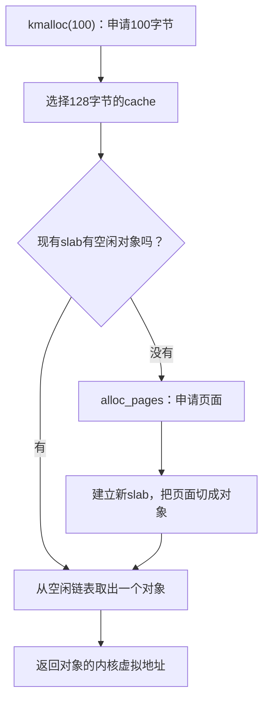

# Lab2 Prompt 记录

本文件集中记录成员 A、B、C 在 lab2 中实际使用的提示词和协作迭代。成员 B 的原始多轮协作记录已合并到本文件；Prompt A-1/A-2/A-3 原文中的 `report/lab2-A.md` 是阶段报告路径，阶段报告内容现已合并到 `report/report.md`，原始提示词路径保留用于记录实际迭代。Prompt A-4/A-5 是按实验手册任务三要求补齐设计的 Buddy System 两份提示词（模块生成与测试设计），已在仓库外临时副本上实际执行验证，生成的模块和测试可正常编译运行；交付代码保留成员 A 的原始实现。代码生成、测试和报告整理的事实边界以实际提交和运行记录为准。

## Prompt A-1：整理 page_init 与 First-Fit 报告结构

```text
[PROMPT]
**任务**：参考 code/labcodes/lab2/lab2_new/kern/mm/pmm.c、pmm.h、memlayout.h 和 default_pmm.c，修改并润色 report/lab2-A.md 中物理内存初始化与 First-Fit 的报告结构。
**操作要求**：只修改实验报告，不修改任何源代码；以工程中的真实定义为依据，按实验执行顺序组织内容。
**输出要求**：直接修改 report/lab2-A.md，保留报告模板的主要章节，不增加未经实际验证的结果。

[RELY]
- 真实接口：page_init、get_memory_base、get_memory_size、init_memmap、pa2page、default_init、default_init_memmap、default_alloc_pages、default_free_pages。
- 真实状态：va_pa_offset、npage、nbase、pages、PageReserved、PageProperty、property、page_link。
- 报告模板包含实验目的、环境、整体逻辑、功能实现、测试验证和总结。

[GUARANTEE]
必须修改和润色以下报告内容：
- page_init 模块说明
- First-Fit 四个核心函数说明
- First-Fit 改进空间
- 地址转换、Page 描述符和保留页知识点
- 未在实验中对应的 OS 原理知识点
不得修改 code/labcodes/lab2/lab2_new 下的任何文件，不得虚构测试输出、截图或 AI 生成代码的事实。

[SPECIFICATION]
## report/lab2-A.md 的 page_init 与 First-Fit 部分
**Pre-Condition**:
- 当前项目源码和实验报告模板均可读取。
- 报告结论必须能够由当前源码或实际测试支持。

**Post-Condition**:
- 报告按“整体逻辑 -> page_init -> First-Fit -> 知识点”的顺序组织。
- 每个函数说明与真实代码中的状态变化相符。
- 未实测内容保留为待验证说明，不写成已通过。

**Case 1**:
- 如果源码定义与草稿表述不一致，以源码为准修改报告。

**Case 2**:
- 如果草稿把推测写成测试结果，改为条件说明或待验证说明。

**Requirements**:
- 只修改、润色报告结构。
- 不生成实验代码，不在报告中加入截图命令，不添加无关内容。
```

## Prompt A-2：润色 Buddy System 实现说明结构

```text
[PROMPT]
**任务**：参考 code/labcodes/lab2/lab2_new/kern/mm/buddy_pmm.c、buddy_pmm.h、pmm.h 和 memlayout.h，修改并润色 report/lab2-A.md 中 Buddy System 实现说明的结构。
**操作要求**：只整理现有代码中的阶次空闲链表、初始区间分解、分裂、释放、伙伴定位和合并；不得修改源代码。
**输出要求**：直接修改 report/lab2-A.md，使 Buddy System 实现部分按数据结构和执行流程组织，不增加源码中不存在的功能。

[RELY]
- 真实接口：buddy_init、buddy_init_memmap、buddy_alloc_pages、buddy_free_pages、buddy_nr_free_pages、buddy_check、buddy_pmm_manager。
- 上层接口：struct pmm_manager、alloc_pages、free_pages、nr_free_pages。
- 页面状态：PageReserved、PageProperty、property、page_link。
- 报告中的截图位置位于 report/images，不提供或编造图片内容。

[GUARANTEE]
必须修改和润色以下报告内容：
- Buddy 数据结构
- 初始化区间分解
- 分配时的阶次计算与分裂
- 释放时的伙伴定位与合并
- 实现边界
不得修改 code/labcodes/lab2/lab2_new 下的任何文件，不得声称 AI 生成了代码，不得虚构编译、QEMU、grade 或截图结果。

[SPECIFICATION]
## report/lab2-A.md 的 Buddy System 实现部分
**Pre-Condition**:
- 已有可阅读的 Buddy System 实现、统一 pmm_manager 接口和实验报告模板。
- 所有行为说明必须与当前实现一致。

**Post-Condition**:
- 报告按“数据结构 -> 初始化 -> 分配 -> 释放合并”的顺序解释实现。
- 说明非二次幂请求、空间不足和伙伴越界时的行为。

**Case 1**:
- 请求不是二的幂时，说明向上取整和实际分配块大小的差异。

**Case 2**:
- 高阶块存在时，说明连续分裂以及右半块进入低阶链表的状态变化。

**Case 3**:
- 释放后伙伴可合并时，说明异或定位、边界检查和重复合并。

**Requirements**:
- 只修改、润色报告结构。
- 源代码、测试结果、截图和环境信息必须保持事实准确。
```

## Prompt A-3：润色 Buddy System 测试说明结构

```text
[PROMPT]
**任务**：参考 code/labcodes/lab2/lab2_new/kern/mm/buddy_pmm.c 中的 buddy_check，修改并润色 report/lab2-A.md 中 Buddy System 测试说明的结构。
**操作要求**：只整理现有测试覆盖的分裂、不同阶次、耗尽失败、伙伴合并、释放复用和计数恢复；不得修改代码，不得生成新测试。
**输出要求**：直接修改 report/lab2-A.md，使每项测试说明都对应真实断言；图片位置保持为空，不写入截图命令。

[RELY]
- buddy_check 使用独立的 16 页描述符区间。
- 3 页请求实际使用 4 页阶次块，另有 4 页和 8 页请求。
- 释放后检查 4+4 合并为 8、8+8 合并为 16，并重新分配 16 页。
- 实际测试结果只能来自终端输出；报告当前仅保留截图占位。

[GUARANTEE]
必须修改和润色以下报告内容：
- 测试前置状态
- 分裂与阶次断言
- 耗尽失败断言
- 两级伙伴合并断言
- 释放后复用断言
- 截图占位
不得修改任何 C 文件，不得虚构 QEMU 或 grade 结果，不得把截图命令写入报告。

[SPECIFICATION]
## report/lab2-A.md 的 Buddy System 测试部分
**Pre-Condition**:
- buddy_check 的当前源码可作为报告事实依据。
- 测试截图尚未添加。

**Post-Condition**:
- 报告按测试执行顺序说明输入、断言和预期状态。
- 每个“通过”结论都需要实际终端输出支持；当前仅描述覆盖目标。
- 三个图片链接保留为空位，正文不包含截图命令。

**Case 1**:
- 3、4、8 页分配耗尽 16 页测试区时，说明阶次向上取整和分裂结果。

**Case 2**:
- 耗尽后继续请求 1 页时，说明预期返回空指针。

**Case 3**:
- 按顺序释放两个 4 页块和一个 8 页块时，说明两级伙伴合并断言。

**Case 4**:
- 合并后重新请求 16 页时，说明释放复用和空闲计数恢复断言。

**Requirements**:
- 只修改、润色测试报告结构。
- 不修改代码，不写截图命令，不编造测试输出。
```

## Prompt A-4：生成 Buddy System 分配模块并接入内核（手册任务三第一份）

```text
[PROMPT]
**任务**：在没有现成 Buddy System 代码框架和测试函数的情况下，参考 ucore 物理内存管理框架（kern/mm/pmm.h 的 struct pmm_manager、kern/mm/default_pmm.c 的参考实现、libs/list.h 的双向链表），从零生成 Buddy System 页级分配模块，写入 kern/mm/buddy_pmm.c 和 kern/mm/buddy_pmm.h，并接入内核。
**操作要求**：
- 直接创建和修改项目文件，不要只展示代码。
- 模块对外只暴露 buddy_pmm_manager；内部状态和辅助函数一律 static。
- 接入方式：kern/mm/pmm.c 的 init_pmm_manager() 已提供 USE_BUDDY_PMM 条件编译路径；若所用代码树没有该路径，则添加一个 `#ifdef USE_BUDDY_PMM` 分支选择 buddy_pmm_manager。构建验证使用 `make DEFS=-DUSE_BUDDY_PMM`。
- 不得修改 pmm.h、default_pmm.c、best_fit_pmm.c 和任何已有测试函数。
**输出要求**：编译无错误无警告；QEMU 启动后输出 `memory management: buddy_pmm_manager`，内核自检通过。

[RELY]
- struct pmm_manager 共 7 个成员：name、init、init_memmap、alloc_pages、free_pages、nr_free_pages、check，签名见 kern/mm/pmm.h。
- 页描述符 struct Page 的字段 flags、property、ref、page_link；宏 PageReserved、PageProperty、SetPageProperty、ClearPageProperty；辅助函数 set_page_ref()。
- le2page(le, page_link) 从链表节点还原页描述符；libs/list.h 提供 list_init、list_add、list_del、list_empty、list_next。
- init_memmap(base, n) 收到的空闲区间不一定按最大块对齐；区间内页都已由 page_init() 标记 PageReserved。
- alloc_pages(n) 必须返回至少 n 个连续页；资源不足返回 NULL；违反前置条件用 assert 终止。
- 默认 QEMU 配置 128 MiB 内存（32768 页），阶次 0..15 足够。

[GUARANTEE]
必须实现并提供以下接口（签名与 struct pmm_manager 成员一致）：
- static void buddy_init(void);
- static void buddy_init_memmap(struct Page *base, size_t n);
- static struct Page *buddy_alloc_pages(size_t n);
- static void buddy_free_pages(struct Page *base, size_t n);
- static size_t buddy_nr_free_pages(void);
- static void buddy_check(void);
- const struct pmm_manager buddy_pmm_manager = { ... };
允许 static 辅助函数（阶次计算、块插入/移出）与模块私有状态（阶次空闲链表数组、空闲页计数、区间基址和页数）。不得改变公开接口或修改其他模块。

[SPECIFICATION]
## buddy_init / buddy_init_memmap
**Pre-Condition**：base..base+n-1 全部为 PageReserved；调用发生在 page_init() 之后、任何分配之前。
**Post-Condition**：初始区间被分解为若干 2^k 页的块并登记到对应阶次空闲链表；buddy_nr_free_pages() 等于 n；空闲块首记录阶次并置 PageProperty。

## buddy_alloc_pages
**Pre-Condition**：n > 0。
**Case 1（常规请求）**：请求向上取整到目标阶次；从该阶次或更高阶链表取块，高阶块逐级对半分裂并登记低阶半块，返回块首页描述符；空闲页计数减少 2^目标阶次。
**Case 2（资源不足）**：空闲页总数不足或找不到足够大的块时返回 NULL，且不改变任何内部状态。
**Case 3（超上界）**：目标阶次超出实现的最高阶次时返回 NULL。

## buddy_free_pages
**Pre-Condition**：base 是此前一次成功分配的块首；n 不超过该块的阶次大小。
**Post-Condition**：整块回到空闲集合；用块首相对页号异或 2^k 定位伙伴，伙伴空闲且同阶则移出并逐级合并，直到无法合并或越界；空闲页计数按被释放块的阶次大小增加，合并不改变计数。
**Case（非法释放）**：base 越界、阶次非法或区间越界时 assert 失败终止。

## buddy_check
**Post-Condition**：至少占位并通过；最终版本由 Prompt A-5 设计。
```

执行记录：该 prompt 已在仓库外临时副本上实际执行。生成的 buddy_pmm.c/h 以 `make DEFS=-DUSE_BUDDY_PMM` 构建无警告，QEMU 启动输出 `memory management: buddy_pmm_manager`，占位自检通过，且 init.c 的 SLUB 四组自检在该 buddy 后端上全部 PASS（SLUB 的 kmalloc/kfree 走 buddy 的 alloc_pages/free_pages，覆盖了真实分配释放路径）。交付目录保留成员 A 的原始实现，不替换。

## Prompt A-5：为生成的 Buddy 分配器设计测试（手册任务三第二份）

```text
[PROMPT]
**任务**：针对 Prompt A-4 生成的 Buddy System 分配模块（kern/mm/buddy_pmm.c），设计一组测试函数写入 buddy_check()（及其调用的 static 测试辅助），检验不同大小内存块的分配、释放、分裂和合并是否正确。不得修改分配逻辑本身。
**操作要求**：
- 直接修改 kern/mm/buddy_pmm.c 中的 buddy_check()；每个断言失败都会触发 assert 终止。
- 用独立的 struct Page 样本数组模拟页描述符区间：先把每页置 PageReserved，再交给 buddy_init()/buddy_init_memmap()；测试结束后必须恢复真实页区间的描述符状态并重新初始化，避免污染后续运行。
- 每组覆盖点通过后用 cprintf 输出分组结果。
**输出要求**：`make DEFS=-DUSE_BUDDY_PMM` 构建后 QEMU 运行，所有分组输出 PASS，内核不 panic，最后输出 buddy_check() succeeded。

[RELY]
- 与 Prompt A-4 相同的框架事实（struct pmm_manager、struct Page、libs/list.h、阶次空闲链表）。
- kern/debug/assert.h 的 assert 失败即 panic；输出用 cprintf。
- 测试区间固定用 16 页样本，可手工推导每个请求的分裂与合并结果并写成精确断言（地址、阶次、计数）。

[GUARANTEE]
必须提供：
- static void buddy_check(void)；（扩展自 A-4 生成的版本）
允许 static 测试辅助（如遍历全部阶次链表校验计数不变量）；不得改变 buddy_alloc_pages、buddy_free_pages 等分配逻辑和公开接口。

[SPECIFICATION]
## 测试覆盖（每个行为都要有明确断言）
1. 阶次取整与分裂：请求 3 页实际消耗 4 页块；连续请求 3、1、8 页的返回地址与空闲计数符合 16 页区间的分裂顺序。
2. 耗尽：空闲页不足或无足够大块时返回 NULL，内部状态不变。
3. 释放顺序：以混合顺序释放全部已分配块，每步计数正确。
4. 两级合并：相邻同阶伙伴释放后合并成高一阶块；继续释放更大块能跨两级合并，最终回到单一最大块（块首阶次可断言）。
5. 复用：全部释放后空闲计数恢复初值，再次请求整个区间能拿到同一地址。
6. 计数不变量：每个关键步骤后，遍历所有阶次空闲链表，块数乘 2^k 之和必须等于空闲页计数。

## 测试为什么有效
以上断言把 Buddy System 的核心不变量——块大小为 2 的幂、伙伴地址满足异或关系、只有同阶空闲伙伴才能合并、空闲页计数守恒——映射为可观察的返回地址、块首阶次和计数检查；任何一条被实现破坏，都会在对应 assert 处 panic，并能从分组输出直接定位违反的行为。
```

执行记录：该 prompt 已在同一临时副本上实际执行。按覆盖点重写 buddy_check() 后重新构建，QEMU 输出 `[Buddy Gen Test] rounding/split: PASS`、`exhaustion: PASS`、`merge/reuse/invariant: PASS` 和 `buddy_check() succeeded!`，内核不 panic。两份 prompt 的执行均为仓库外验证，交付代码与测试保持成员 A 的原始版本。

## Prompt B：Best-Fit 与 SLUB 协作记录

### Prompt B-1: 原始协作记录

这是lab2分工，我负责成员B部分，不直接做这个内容，告诉我完成的步骤是什么。


星期六12:58


用时 2m 4s


你负责的是 成员 B：Best-Fit 连续页分配器 + SLUB 任意大小对象分配器。建议按下面顺序做，不要一上来就写 SLUB：它依赖底层页分配接口。
建议步骤
1. 先和 A、C 对齐接口
   - 问成员 A：page_init() 和 init_memmap() 完成后，空闲页的状态、页数和地址范围怎么表示？
   - 问成员 C：SLUB 的分配/释放函数要叫什么、放在哪个文件、用什么测试入口？
   - 尤其注意：A 和你都可能碰到 pmm.c。提前约好谁改哪几行，避免覆盖彼此代码。
2. 读懂现有 First-Fit
   重点读 kern/mm/pmm.h、kern/mm/default_pmm.c 和 tools/test_lab2.c。先搞清楚管理器接口，以及空闲块是如何记录、分配和释放的。Best-Fit 要遵循这些既有接口，不能改变检查代码的约定。
3. 实现 Best-Fit
   在 kern/mm/best_fit_pmm.c 补齐管理器状态、初始化、空闲区登记、分配和释放：
   - 分配连续页时，遍历空闲块，选出够用且最小的那块。
   - 如果选中的块比请求大，就把剩余部分保留为空闲块。
   - 释放时把页面重新放回空闲管理结构，并合并相邻空闲块。
   - 处理没有足够空闲页等失败情况。
   然后按约定在 pmm.c 注册或切换到 Best-Fit。改动前先与 A 协调，因为 A 也负责 pmm.c 的物理内存初始化。
4. 先验证 Best-Fit，再做 SLUB
   用现有测试验证初始化、分配、释放、合并和失败路径；再补针对 Best-Fit 的场景，例如同时有大小不同的空闲块时，确认选中的是“最合适的最小块”。记录真实执行过的命令和输出。
5. 设计并实现 SLUB
   先和 C 约定对外接口以及如何调用测试，再确定内部组织。设计时要说明：
   - 小对象如何按大小分类、怎样从 slab 中取出空闲对象；
   - 一个 slab 用完后如何申请新页；
   - 释放对象后怎样复用；
   - 大对象或超过最大缓存类别的请求如何处理；
   - 对齐、无效指针、耗尽等情况怎样处理。
   SLUB 必须通过双方约定的页级接口申请和释放内存，不要另造一套与页管理器冲突的入口。
6. 为 SLUB 补测试
   至少覆盖不同大小对象、连续分配、释放后复用、跨 slab、对齐、没有内存时的失败行为。测试结果要来自真实运行；没跑过的项目不能写成已通过。
7. 整理自己的交付并提交
   提交代码、测试、你自己的实现说明、实际使用过的提示词和测试记录。写清变更文件、运行命令、关键输出和已知限制。按分工文档约定，提交信息可写成：
   lab2: member-b add best-fit and slub allocators
   不要提交 bin/、obj/、临时日志或压缩包；提交前确认没有覆盖 A、C 的改动。
**一句话说你的工作顺序：**先弄懂 First-Fit 和公共页接口，完成并验证 Best-Fit，再和组员确定 SLUB 接口，完成 SLUB 与测试，最后把自己的代码和证据交给 C 集成。

### Prompt B-2: 原始协作记录

怎么做？讲解一下


星期六13:41


用时 32s


先做 Best-Fit 页分配器。它和 First-Fit 的区别很简单：First-Fit 找到第一个够大的空闲块就用；Best-Fit 会把所有够大的空闲块都看一遍，选出最小的那个，尽量少浪费空间。
例如要分配 5 页，现在有 4 页、10 页、6 页三个空闲块。First-Fit 可能选 10 页；Best-Fit 会选 6 页，分配 5 页后留下 1 页。
一、先看懂接口和现成实现
打开 `OS2026/code/labcodes/lab2/lab2_new/kern/mm/pmm.h`，里面的 pmm_manager 规定了一个分配器必须提供什么操作：
- init()：初始化空闲链表和空闲页数。
- init_memmap(base, n)：把一段物理页登记为空闲区。
- alloc_pages(n)：分配至少 n 个连续页。
- free_pages(base, n)：释放一段连续页。
- nr_free_pages()：返回空闲页总数。
- check()：运行分配器自检。
然后读 `OS2026/code/labcodes/lab2/lab2_new/kern/mm/default_pmm.c`。它已经展示了链表维护、切分空闲块和释放时合并相邻块的做法。Best-Fit 可以沿用这些页面状态规则，主要区别在分配时如何选块。
二、在 best_fit_pmm.c 完成这些操作
文件位置：`OS2026/code/labcodes/lab2/lab2_new/kern/mm/best_fit_pmm.c`
1. 维护自己的状态：准备一个空闲链表和一个 nr_free 计数。空闲块的头页用 property 记录块大小，并设置 PageProperty。
2. 初始化空闲区：对传入的每个页面清除旧状态，再把整段登记为一个空闲块，更新空闲页数。
3. 分配页面：遍历空闲链表，记住所有 property >= n 的块中最小的那个。找到后从块头分配 n 页；若块还有剩余，把剩下的页面登记成新的空闲块。找不到就返回 NULL。
4. 释放页面：先恢复页面状态，再把释放区间按地址插入空闲链表。然后检查它和前、后空闲块是否物理相邻，相邻就合并。
5. 保持计数正确：分配时减 n，释放时加 n；合并只改变空闲块的组织方式，不额外改变空闲页总数。
合并时可以这样判断相邻关系：
前一个块的起点 + 前一个块的页数 == 当前块起点
当前块起点 + 当前块的页数 == 后一个块起点
现有的 basic_check() 和 best_fit_check() 是框架检查，不要修改它们。
三、让内核真正使用 Best-Fit
目前 `OS2026/code/labcodes/lab2/lab2_new/kern/mm/pmm.c` 的选择逻辑是：定义 USE_BUDDY_PMM 就用 Buddy，否则用 First-Fit。你需要增加 Best-Fit 的选择路径，并保留 Buddy 路径，例如按下面的优先关系处理：
定义 USE_BUDDY_PMM     → Buddy
定义 USE_BEST_FIT_PMM  → Best-Fit
都没定义               → First-Fit
选对分配器后，pmm_manager->check() 才会运行对应分配器的检查。仓库里的 test_best_fit() 还会检查当前是否确实选中了 best_fit_pmm_manager。
四、在终端里验证
在终端进入：
cd OS2026/code/labcodes/lab2/lab2_new
先编译：
make clean
make DEFS=-DUSE_BEST_FIT_PMM
再运行课程检查：
make DEFS=-DUSE_BEST_FIT_PMM grade
重点看输出里是否有 Best-Fit 检查通过和最终分数。还要运行 make qemu 确认内核能启动。若 QEMU 因 -device loader 报兼容错误，那是启动参数问题，先记录报错并找 A 对齐启动方式，不要误判成 Best-Fit 算法错误。
测试时重点核对：选择了最小够用块、剩余页能再次分配、释放相邻块后能合并、没有足够页面时返回失败、最后空闲页数能恢复。现有检查覆盖了一些分配与释放场景；你还需要特别确认选块策略本身确实是 Best-Fit。
五、Best-Fit 之后再做 SLUB
SLUB 管的是“对象”，底层仍向页分配器申请页面。可以把它理解成两层：
SLUB 对象分配器
    ↓ 需要一批页面时
Best-Fit 页分配器
SLUB 需要按对象大小管理 cache/slab：有空位就从对应 slab 取一个对象；没有空位就向页分配器申请页面建立 slab；释放对象时把槽位还回去，空 slab 则可以归还页面。测试需要覆盖不同对象大小、对齐、释放后复用、多个 slab，以及空间耗尽。
你现在的第一步：在 best_fit_pmm.c 里先完成“初始化—登记—分配—释放合并”四部分，并让 pmm.c 能选择它。Best-Fit 通过检查后，再和 C 对齐 SLUB 的文件和接口。

### Prompt B-3: 原始协作记录

看下我目前代码，告诉我具体哪行怎么改


星期六17:02


用时 36s


我看了当前版本。下面按当前行号说具体怎么改；行号会随着插入代码而变化。现在还不能通过检查，主要问题是链表插入函数同时改了块大小和计数，导致后续账目不一致。
1. 改 insert_free_block()：只负责链表
在 `best_fit_pmm.c` 第 16–41 行，删除所有 `base->property = 1` 和 `nr_free++`。这个函数只负责按地址插入：
static void
insert_free_block(struct Page *base) {
    if (list_empty(&free_list)) {
        list_add(&free_list, &base->page_link);
        return;
    }

    list_entry_t *le = &free_list;
    while ((le = list_next(le)) != &free_list) {
        struct Page *p = le2page(le, page_link);
        if (base < p) {
            list_add_before(le, &base->page_link);
            return;
        }
        if (list_next(le) == &free_list) {
            list_add(le, &base->page_link);
            return;
        }
    }
}
特别是当前第 26 行，建议改成 list_add_before(le, ...)，意思更直接：把新块插在 le 对应块之前。
2. 改 best_fit_init_memmap()
当前第 42 行的函数名是 est_fit_init_memmap，少了开头的 b。把第 42 行改为：
best_fit_init_memmap(struct Page *base, size_t n) {
然后调整函数体：
- 第 44–47 行逐页清理状态时，加入 assert(PageReserved(p)) 和 list_init(&p->page_link)。
- 第 50 行把 nr_free += 1 改成 nr_free += n。
- 最后调用 insert_free_block(base)。
这个函数可以整理成：
static void
best_fit_init_memmap(struct Page *base, size_t n) {
    assert(n > 0);

    for (struct Page *p = base; p != base + n; p++) {
        assert(PageReserved(p));
        p->flags = 0;
        p->property = 0;
        set_page_ref(p, 0);
        list_init(&p->page_link);
    }

    base->property = n;
    SetPageProperty(base);
    nr_free += n;
    insert_free_block(base);
}
这里计数加 n，因为登记的是 n 页，不是一个块。
3. 改 best_fit_alloc_pages()
当前第 62–67 行“遍历所有块并找最小合适块”的想法是正确的。函数开头加上总空闲页检查：
if (n > nr_free) {
    return NULL;
}
然后把当前第 71–79 行替换为下面的拆分和记账逻辑：
size_t old_size = best_fit->property;
list_entry_t *prev = list_prev(&best_fit->page_link);
list_del(&best_fit->page_link);
ClearPageProperty(best_fit);
best_fit->property = 0;

if (old_size > n) {
    struct Page *remain = best_fit + n;
    remain->flags = 0;
    remain->property = old_size - n;
    SetPageProperty(remain);
    list_init(&remain->page_link);
    list_add(prev, &remain->page_link);
}

nr_free -= n;
return best_fit;
所以当前第 79 行的 nr_free-- 必须改掉：申请 n 页就要减少 n，不能只减 1。拆分剩余块时也不要再调用当前这个会改计数的插入逻辑；修好第一步后，insert_free_block() 就只管链表排序了。
4. 补全 best_fit_free_pages()
当前第 83–90 行只登记了块头，没有清理页面、更新总数或合并邻块。整个函数体需要补成下面的顺序：
assert(n > 0);

for (struct Page *p = base; p != base + n; p++) {
    assert(!PageReserved(p) && !PageProperty(p));
    p->flags = 0;
    p->property = 0;
    set_page_ref(p, 0);
    list_init(&p->page_link);
}

base->property = n;
SetPageProperty(base);
nr_free += n;
insert_free_block(base);

// 若前一块紧邻 base，则合并到前一块
list_entry_t *le = list_prev(&base->page_link);
if (le != &free_list) {
    struct Page *prev = le2page(le, page_link);
    if (prev + prev->property == base) {
        prev->property += base->property;
        ClearPageProperty(base);
        list_del(&base->page_link);
        base = prev;
    }
}

// 若后一块紧邻当前块，则合并后一块
le = list_next(&base->page_link);
if (le != &free_list) {
    struct Page *next = le2page(le, page_link);
    if (base + base->property == next) {
        base->property += next->property;
        ClearPageProperty(next);
        list_del(&next->page_link);
    }
}
注意：nr_free += n 只加一次。与前后块合并时，不要再改总页数。
5. 补上空闲页查询和管理器登记
在框架检查函数之前增加：
static size_t
best_fit_nr_free_pages(void) {
    return nr_free;
}
当前第 92–98 行的管理器对象放得太早，而且缺少两个接口。把它移到 best_fit_check() 之后，并补齐字段：
const struct pmm_manager best_fit_pmm_manager = {
    .name = "best_fit_pmm_manager",
    .init = best_fit_init,
    .init_memmap = best_fit_init_memmap,
    .alloc_pages = best_fit_alloc_pages,
    .free_pages = best_fit_free_pages,
    .nr_free_pages = best_fit_nr_free_pages,
    .check = best_fit_check,
};
这样 .check 能调用已有的测试函数，.nr_free_pages 能提供 nr_free_pages() 所需的总数。
6. 让 pmm.c 选择 Best-Fit
在 `pmm.c` 第 38–42 行加一个分支：
#ifdef USE_BUDDY_PMM
    pmm_manager = &buddy_pmm_manager;
#elif defined(USE_BEST_FIT_PMM)
    pmm_manager = &best_fit_pmm_manager;
#else
    pmm_manager = &default_pmm_manager;
#endif
改完后，在 labcode/lab2 目录编译和运行检查：
make clean
make DEFS=-DUSE_BEST_FIT_PMM
make DEFS=-DUSE_BEST_FIT_PMM grade
我目前只做了代码静态检查，没有运行这些命令。

### Prompt B-4: 原始协作记录

介绍一下slub的前置知识，slub是什么？用大白话先笼统讲如何完成？再笼统讲一下如何实现？


星期日16:55


用时 6m 38s


SLUB 就是：先向页分配器拿一大块内存，再切成许多小格子，供内核按“对象”分配和回收。
你已经完成的 Best-Fit 按页分配。假设一页是 4096 字节，内核现在只需要一个 64 字节的结构体，直接分一整页会浪费很多空间。SLUB 可以把页面切成多个 64 字节的格子，每次给调用者一个格子。
Linux 的 SLUB 属于 slab 对象分配器这一类，围绕对象缓存、slab 和空闲对象链表组织内存。下面我们设计的是适合你这个实验的简化版本。Linux SLUB 源码
先把几项前置知识连起来：
概念	大白话解释	和你目前代码的关系
页	一大块固定大小的内存，本实验为 4096 字节	alloc_pages() 分配它
对象	程序实际需要的一块内存，比如一个结构体	kmalloc(64) 分配至少 64 字节
空闲链表	把暂时没人使用的内存串起来	Best-Fit 串空闲块，SLUB 串空闲对象
对齐	对象起始地址必须是某个数的整数倍	例如 16 字节对齐要求 地址 % 16 == 0
元数据	管理内存所需的记录	记录所属 slab、空闲位置、已使用数量等


特别注意：struct Page * 是描述页面的记录，不是那一页内存本身。SLUB 拿到 Page 后，还要转换成内核可以访问的内存地址。
接着区分三个容易混淆的词：
名称	可以理解成什么
object	一个小格子，最终交给调用者
slab	一块已经被切成许多格子的内存，由一页或多页组成
cache	某一种规格格子的管理器，比如专门管理 128 字节对象


例如，128 字节 cache 可以管理很多个 slab；每个 slab 里又有多个 128 字节对象。这里的 cache 是软件维护的对象缓存。
一次分配大致这样走：

所以，你的 Best-Fit 和 SLUB 是上下两层：Best-Fit 提供页面，SLUB 使用页面提供小对象。 SLUB 不需要注册成另一个 pmm_manager。
笼统地讲，完成这个模块就是以下过程：
1. 准备若干对象规格，例如 16、32、64、128、256、512、1024、2048 字节。
2. 请求到来时，选择能装下它的最小规格。例如申请 100 字节，选择 128 字节。
3. 从对应 cache 的 slab 中拿一个空闲对象；没有空闲位置时，再向 Best-Fit 申请页面并建立新 slab。
4. 释放对象时，把它放回空闲链表，留给后面的请求复用。
5. 一个 slab 的对象全部释放后，把整块页面还给页分配器。
这里仍可能有内部碎片：申请 100 字节拿到 128 字节，会多占 28 字节。尺寸分档是在管理成本和空间利用率之间取舍。
下面落到代码。以下是设计示例和核心片段，还不是可以直接粘贴运行的完整实现。
你可以新增 kern/mm/slub.h 和 kern/mm/slub.c，先对外提供：
void slub_init(void);
void *kmalloc(size_t size);
void kfree(void *ptr);
void slub_check(void);
slub_init() 初始化各个 cache；kmalloc() 返回对象地址；kfree() 回收对象；slub_check() 用来做本模块自检。kmalloc、kfree 也是 Linux 内核常用的对象分配、释放接口名称。Linux 内存分配 API
第一步，设计需要保存的状态。
struct kmem_cache;

struct slab {
    struct kmem_cache *cache;  // 属于哪个规格的 cache

    struct Page *pages;       // 后端页面的描述符
    size_t npages;            // 向页分配器申请的页数

    void *objects;            // 第一个对象的起始地址
    void *freelist;           // 第一个空闲对象

    size_t capacity;          // 总共有多少个对象
    size_t inuse;             // 当前有多少个对象正在使用

    list_entry_t link;        // 挂到所属 cache 的 slab 链表
};

struct kmem_cache {
    size_t object_size;       // 该规格保证提供的字节数
    size_t stride;            // 相邻对象之间的实际距离

    struct slab *active;      // 当前优先使用的 slab
    list_entry_t slabs;       // 这个 cache 管理的所有 slab
};
这些变量和你熟悉的 Best-Fit 有对应关系：freelist 记录还能分配的位置，capacity 记录总格子数，inuse 记录已经借出去多少个。可用对象数量就是 capacity - inuse。
object_size 和 stride 要区分。例如对象需要 20 字节，但要求 16 字节对齐，相邻对象之间的距离应当向上取整为 32 字节。
空闲对象里还要能放下一个链表指针，因此可以这样计算：
stride = ROUNDUP(MAX(object_size, sizeof(void *)), 16);
这里的 16 是我们为教学实现选择的默认对齐值。
第二步，实现“新建一个 slab”。
这个函数可以叫：
static struct slab *new_slab(struct kmem_cache *cache);
它先拿一页：
struct Page *page = alloc_pages(1);
if (page == NULL) {
    return NULL;
}
然后转换为实际可访问的内核虚拟地址。按照你目前工程的地址布局，可以使用：
char *base = (char *)(page2pa(page) + va_pa_offset);
这一步相当于：
Page 描述符 → 页面物理地址 → 内核虚拟地址
我们可以把 slab 的管理信息放在页面开头，对象放在后面：
一页内存：
┌────────────┬──────────┬────────┬────────┬─────┐
│ slab元数据 │ 对齐填充 │ 对象0  │ 对象1  │ ... │
└────────────┴──────────┴────────┴────────┴─────┘
对应计算为：
struct slab *s = (struct slab *)base;

uintptr_t start =
    ROUNDUP((uintptr_t)base + sizeof(*s), 16);

s->objects = (void *)start;

size_t available =
    PGSIZE - (start - (uintptr_t)base);

s->capacity = available / cache->stride;
元数据和对齐填充都占空间，所以不能直接用 4096 / object_size 当对象数量。
第三步，把对象串成空闲链表。
一个对象空闲时，可以借用它前几个字节保存“下一个空闲对象”的地址：
freelist → 对象2 → 对象1 → 对象0 → NULL
建立链表：
s->freelist = NULL;
s->inuse = 0;

for (size_t i = 0; i < s->capacity; i++) {
    void *obj =
        (char *)s->objects + i * cache->stride;

    *(void **)obj = s->freelist;
    s->freelist = obj;
}
*(void **)obj 比较绕，可以拆开理解：
- obj 指向一个空闲格子。
- (void **)obj 把格子开头看成“存放指针的位置”。
- *(void **)obj = ... 把下一个格子的地址写进去。
对象分配出去后，这些字节就交给调用者使用，分配器不会继续把它当作空闲链表节点。
第四步，实现 kmalloc()。
它的流程是：
void *kmalloc(size_t size) {
    // 1. 处理 size == 0，按本模块约定返回 NULL
    // 2. 选择能容纳 size 的最小 cache
    // 3. 优先使用 cache->active
    // 4. active 已满时，寻找其他有空位的 slab
    // 5. 都没有空位时，调用 new_slab()
    // 6. 从 slab 的空闲链表取出一个对象
}
从已经找到的 slab 中取对象，核心只有几行：
void *obj = s->freelist;

s->freelist = *(void **)obj;
s->inuse++;

return obj;
也就是取下链表头，把下一个空闲对象变成新的链表头，并记录“又借出一个”。
如果 alloc_pages() 失败，kmalloc() 应返回 NULL，同时保证已经存在的 cache、slab 和计数不被破坏。
第五步，实现 kfree()。
释放对象首先要解决一个问题：这个地址属于哪个 slab？
你目前的 struct Page 没有保存 slab 指针的字段。第一版可以遍历各 cache 的 slab 链表，根据对象地址范围查找所属 slab。实现容易理解，代价是释放时需要搜索。
找到之后还要检查：
- 地址是否落在有效对象区域。
- 地址是否恰好是某个对象的起始位置。
- 这个对象是否确实处于已分配状态。
第二项可以这样检查：
uintptr_t offset =
    (uintptr_t)ptr - (uintptr_t)s->objects;

if (offset % s->cache->stride != 0) {
    // 传入了对象内部的地址，不能释放
}
但范围和对齐检查不能识别重复释放。要检测重复释放，可以给每个 slab 增加一个分配位图：每个对象对应一位，分配时置 1，释放时清 0。
确认可以释放后，把对象插回空闲链表：
*(void **)ptr = s->freelist;
s->freelist = ptr;
s->inuse--;
当 s->inuse == 0 时，说明这个 slab 的对象都归还了。此时先从 cache 链表中移除它、清理可能指向它的 active，保存好 pages 和 npages，再调用：
free_pages(pages, npages);
单个对象释放时只是回到 slab；整个 slab 空了，才把页面还给页分配器。
第六步，补上大对象路径。
只做 16～2048 字节的 cache，还不能覆盖分工里“任意大小对象”的要求。超过小对象规格的请求，可以单独申请多页：
所需空间 = slab元数据 + 对齐填充 + 对象大小
所需页数 = 所需空间向上取整到页数
这块 slab 只放一个对象，释放对象时就回收整块页面。计算大小时需要先检查整数溢出，申请失败则返回 NULL。“任意大小”仍然受可用内存和连续页分配能力限制。
最后再把 slub_init() 和自检接到物理内存初始化完成之后，验证不同大小、多个对象互不覆盖、释放复用、跨 slab、对齐、大对象及内存耗尽。页面回收测试尤其有用：记录开始时的 nr_free_pages()，完成分配和全部释放后，确认空闲页数量恢复。
你实际写代码时，建议先只实现一个 64 字节 cache：完成“拿一页 → 切对象 → 分配两个 → 释放 → 再分配复用”。这条链路跑通后，再扩展尺寸档位、多 slab 和大对象路径，理解和排错都会容易很多。


星期日17:03

## Prompt C-1：成员 C 联调、验证与最终交付

```text
[PROMPT]
任务：作为 lab2 成员 C，整合成员 A 的 page_init、First-Fit、Buddy System 与成员 B 的 Best-Fit、SLUB 实现，完成代码联调、验证记录和最终交付整理。

操作要求：
- 核对 pmm_manager 接口、管理器选择、初始化调用顺序和 SLUB 初始化入口。
- 检查 Makefile、课程 grade 脚本、成员 B 自动验证脚本及报告图片引用。
- 保留成员 A、B 的实现和验证证据，不覆盖已有工作。
- 直接更新最终报告和提示词记录，不把未执行的测试写成通过。

输出要求：
- 将实际执行过的命令、关键输出和失败原因写入 report/report.md。
- 将本次集成提示词加入 report/prompt.md。
- 确认 report/images/ 中的图片均被正确引用。
- 不提交 bin、obj、日志、压缩包或本地工具配置。

[RELY]
- 代码目录：code/labcodes/lab2/lab2_new
- 主要接口：pmm_init()、init_pmm_manager()、page_init()、init_memmap()、alloc_pages()、free_pages()
- 页级管理器：default_pmm_manager、best_fit_pmm_manager、buddy_pmm_manager
- 选择宏：USE_BEST_FIT_PMM、USE_BUDDY_PMM
- SLUB 入口：slub_init()、slub_check()
- 验证入口：Makefile 中的 qemu、grade，以及 tools/check_member_b.py
- 最终交付：report/report.md、report/prompt.md、report/images/

[GUARANTEE]
- 不改变公开接口和已有函数签名。
- 如果发现 A、B 的代码冲突，先按当前源码和测试结果协调整合，不覆盖已有实现。
- 只记录实际执行过的构建、QEMU、grade 和自动验证命令。
- 工具链、QEMU 或 WSL 环境不可用时，记录为环境限制，不声称测试通过。
- 不把课程 grade 结果代替 SLUB、Buddy 或非法释放的专项测试结论。

[SPECIFICATION]
### 代码联调

Pre-Condition：
- A、B 的代码已位于同一 lab2 分支。
- 当前源码可以读取，Makefile 和测试入口存在。

Post-Condition：
- pmm_init() 能够正确选择页级管理器。
- page_init()、init_memmap()、alloc_pages() 和 free_pages() 的调用链保持一致。
- slub_init() 在页级内存初始化后执行。
- 不同后端选择宏不会破坏默认 First-Fit、Best-Fit 和 Buddy 路径。

### 测试验证

Pre-Condition：
- 工具链和 QEMU 可用，或已明确记录环境限制。

Post-Condition：
- 执行可用的 make、make qemu、make grade 和成员 B 自动验证。
- 记录 Page Init、Best-Fit、SLUB、Buddy 和非法释放测试的实际结果。
- 每项“通过”结论都能对应终端输出或有效截图。

Case 1：
- 工具缺失或命令失败时，保留失败输出并说明未验证部分。

Case 2：
- 发现报告、截图或命令与实际结果不一致时，按实际结果修正。

Case 3：
- 发现代码冲突或测试失败时，不覆盖成员工作，不写成通过，记录待处理问题。

### 最终交付

Post-Condition：
- report/report.md 为唯一最终实验报告。
- report/prompt.md 包含 A、B、C 的全部实际提示词记录。
- 报告中的图片链接均指向 report/images/ 中存在的文件。
- Git 工作区无未预期修改，且不包含构建产物和临时文件。
```

## Prompt C-2：成员 C 的验证截图与交付证据

```text
[PROMPT]
任务：作为 lab2 成员 C，整理自己的构建、QEMU/SLUB 自检和课程评分证据，并把三张真实截图加入最终实验报告。

操作要求：
- 在包含 lab2 Makefile 的目录中使用课程要求的 RISC-V 工具链和 QEMU 4.1.1。
- 依次执行构建、QEMU/SLUB 自检和 make grade，保留终端中的真实命令与输出。
- 只保留三张成员 C 截图：构建、QEMU/SLUB、课程评分；不把未提供的完整自动验证截图写入报告。
- 将截图放入 report/images/，并在 report/report.md 的成员 C 验证部分使用相对路径引用。

输出要求：
- 构建截图：lab2-C-build.png。
- QEMU/SLUB 截图：lab2-C-qemu-slub.png。
- 课程评分截图：lab2-C-grade.png。
- 报告只陈述截图中实际出现的版本、检查结果和评分，不补造未显示的输出。

[RELY]
- 代码目录：code/labcodes/lab2/lab2_new
- 工具链前缀：riscv64-unknown-elf-
- QEMU 路径：/opt/qemu-4.1.1/bin/qemu-system-riscv64
- Best-Fit 选择宏：USE_BEST_FIT_PMM
- 报告和图片目录：report/report.md、report/images/
- 验证命令：make、make qemu、make grade

[GUARANTEE]
- 不修改实验源代码，不把截图中的命令或输出手工改写成通过。
- 不使用成员 A、B 的截图冒充成员 C 的验证证据。
- QEMU 因 timeout 正常终止时，只记录终止前已经出现的检查结果。
- 工具链、QEMU 或构建失败时，保留失败信息并在报告中说明环境限制。
- 不提交临时日志、交换文件、bin/、obj/ 或其他构建生成物。

[SPECIFICATION]
### 构建截图

Pre-Condition：
- 当前目录包含 lab2 Makefile，工具链可执行。

Post-Condition：
- 截图显示 GCC 版本、QEMU 4.1.1、源文件编译和内核镜像生成。

### QEMU/SLUB 截图

Pre-Condition：
- Best-Fit 后端能够启动 QEMU。

Post-Condition：
- 截图显示 best_fit_pmm_manager、Best-Fit 检查和 SLUB 检查的实际 PASS 输出。

### 课程评分截图

Pre-Condition：
- make grade 能够完成课程评分脚本。

Post-Condition：
- 截图显示 page init: OK、best fit: OK 和 Total Score: 20/20。

### 交付检查

Post-Condition：
- 三张截图均存在于 report/images/。
- report/report.md 的图片链接全部有效。
- report/prompt.md 记录本次截图和交付整理提示词。
```
