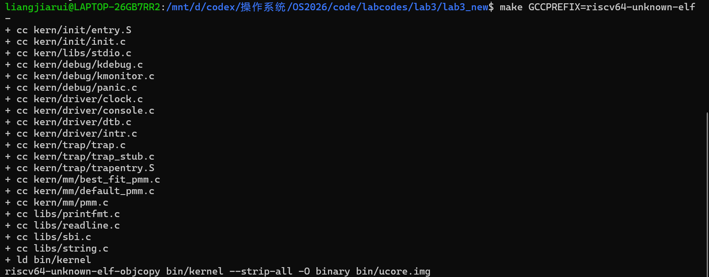
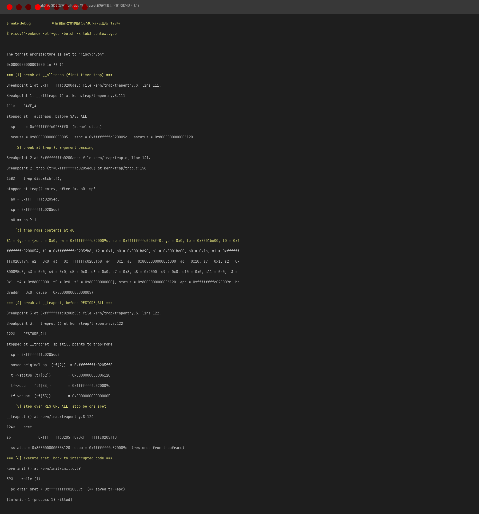
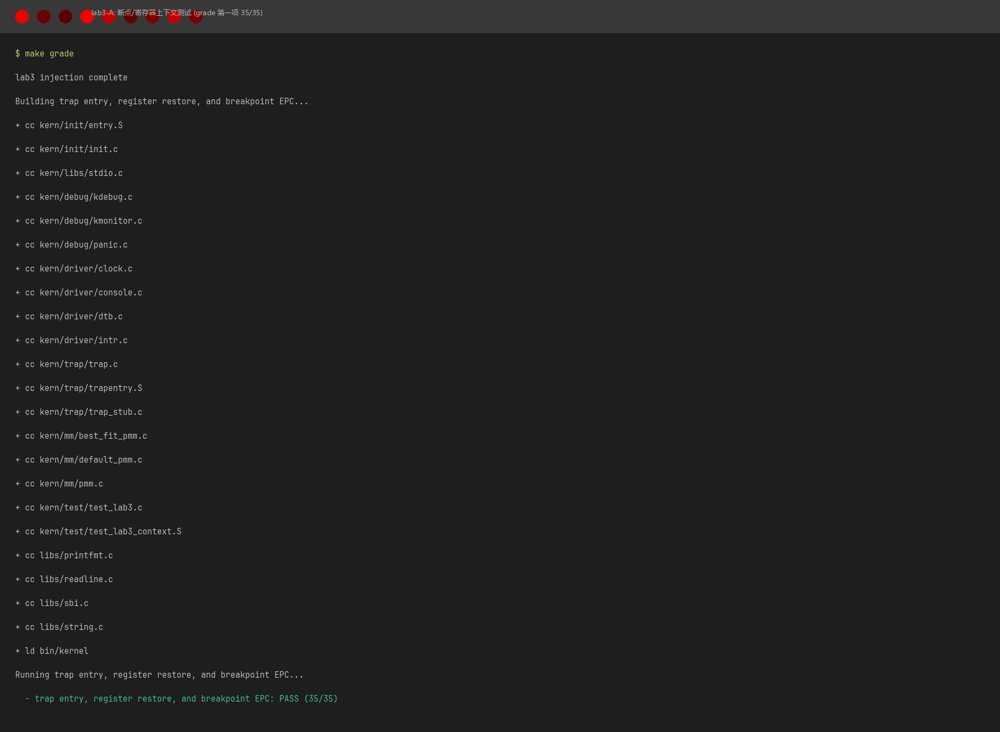
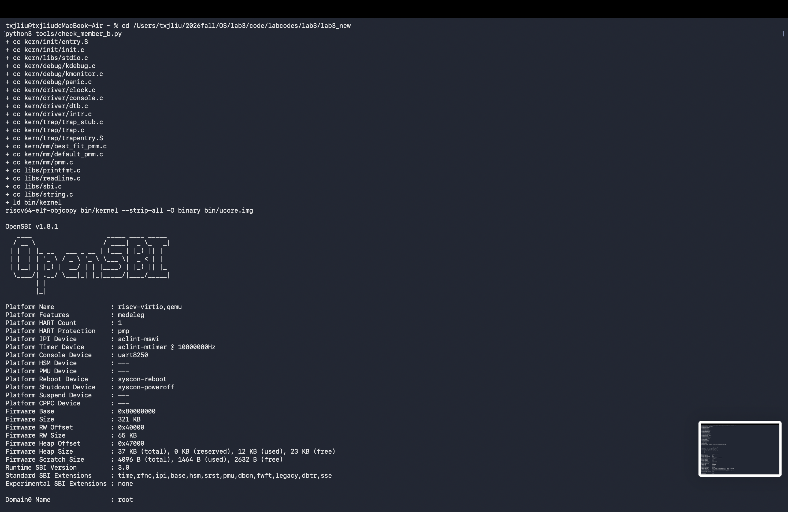
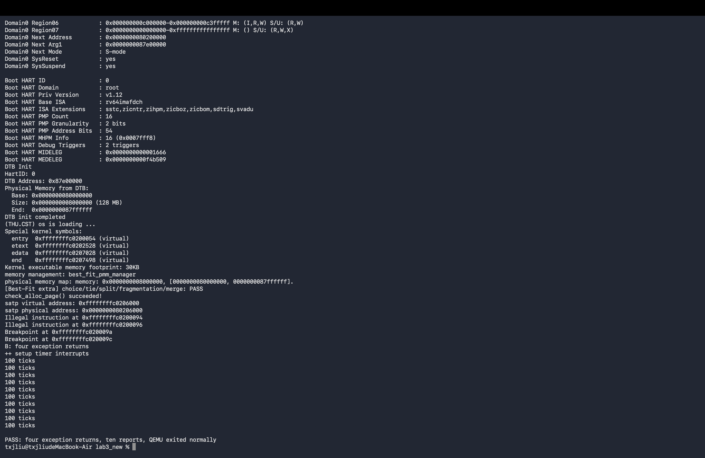
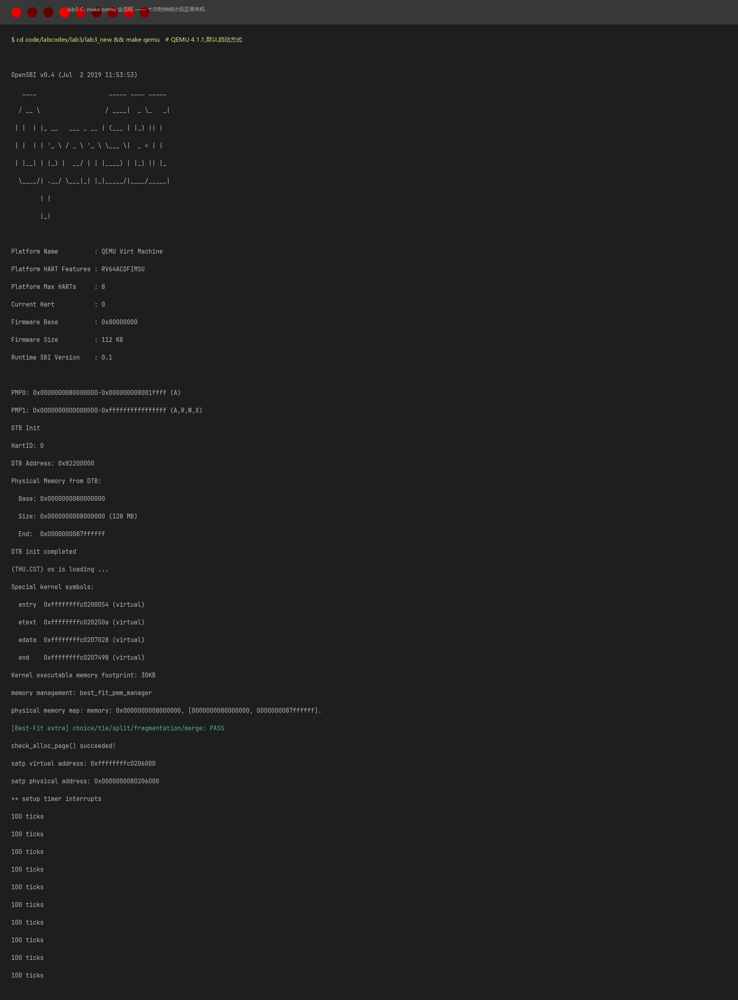
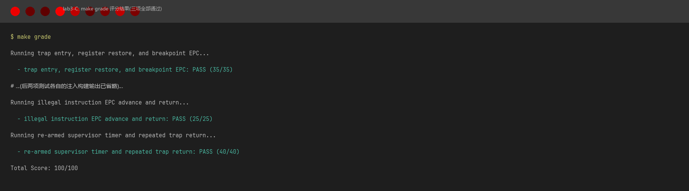

# 操作系统实验报告

## 实验基本信息

| 项目 | 内容 |
|------|------|
| **实验名称** | Lab 3：中断与异常处理 |
| **小组成员** | 2411046-梁家瑞、2412727-刘蔚霖、2411041-李培涛 |
| **完成日期** | 2026-10-27（框架导入与 lab2 迁移）；2026-11-03（成员 A/B 实现合入）；2026-11-04（联调验证与最终报告） |

### 小组分工

| 成员 | 负责的练习/模块 |
|------|----------------|
| 2411046-梁家瑞（成员 A） | 功能模块一：Trap 上下文恢复与 Trap 入口（`kern/trap/trapentry.S` 的 `RESTORE_ALL`、`__alltraps`） |
| 2412727-刘蔚霖（成员 B） | 功能模块二：中断与异常处理（`kern/trap/trap.c` 的 `interrupt_handler()`、`exception_handler()`） |
| 2411041-李培涛（成员 C） | lab2 代码迁移、接口集成、联调验证（QEMU/GDB/grade）、报告与交付检查 |

---

## 一、实验目的

1. 理解 RISC-V 的 Trap 机制：中断、异常、`stvec`、`sepc`、`scause`、`sstatus` 与 `sret`。
2. 掌握 Trap 上下文的保存与恢复，理解 `SAVE_ALL` / `RESTORE_ALL` 与 `struct trapframe` 的对应关系。
3. 实现时钟中断、非法指令异常和断点异常的处理，保证异常返回后不会重复执行同一条指令。
4. 使用 GDB 观察 Trap 全过程，把汇编入口、C 处理函数和 Trap 返回串成可验证的闭环。
5. 继续使用 AI 辅助开发，记录提示词迭代、实现问题和验证证据。

---

## 二、实验环境

| 成员 | 环境与工具 | 验证边界 |
|------|------------|----------|
| 成员 A | OS2026 工程、RISC-V 64、`riscv64-unknown-elf-` 工具链、QEMU 4.1.1 | 汇编布局静态核对与构建验证；GDB 运行时验证在小组联调中由成员 C 复核 |
| 成员 B | macOS、`riscv64-elf-gcc 16.2.0`、QEMU 11.1.2 | 提供 `trap.c` 实现、`tools/check_member_b.py` 复验脚本及实测截图 |
| 成员 C | Fedora、`riscv64-unknown-elf-gcc 15.1.0`、QEMU 4.1.1（本地 `/opt/qemu-4.1.1`） | 完成默认 `make qemu`、`make grade` 与 GDB 联调复核 |

代码目录：`code/labcodes/lab3/lab3_new`，目标架构 RISC-V 64，默认 QEMU 物理内存 128 MiB。

三名成员均使用模型 `gpt 6.1 sol`；AI 工具名称未在本次交付中统一记录，不据此推断其他工具信息。协作方式为：成员 A 的汇编代码由本人依据 `SAVE_ALL` 布局与 RISC-V ABI 编写核对，AI 仅用于报告组织；成员 B 由 AI 生成处理函数并用自动化脚本验证；成员 C 使用四段式提示词完成框架迁移、集成与联调。

---

## 三、实验整体逻辑分析

### 3.1 逻辑主线

Lab3 在 Lab2 的物理内存管理和页表基础上加入 Trap 处理。RISC-V 把中断（异步，如时钟中断）和异常（同步，如非法指令、`ebreak`）统一为 Trap：处理器把原因写入 `scause`、返回地址写入 `sepc`，跳转到 `stvec` 指向的入口。处理 Trap 不能只跳到一个 C 函数，必须先保存被打断代码的完整现场，返回前再恢复，否则寄存器、栈和控制状态都会被破坏。

内核启动主线：

```text
kern_init → dtb_init → pmm_init → idt_init（stvec = __alltraps）
         → clock_init → intr_enable → 时钟中断持续触发
```

一次 Trap 的处理主线：

```text
硬件写入 scause/sepc/stval/sstatus
  → __alltraps → SAVE_ALL（现场存入栈上 struct trapframe）
  → mv a0, sp; jal trap
  → trap_dispatch → interrupt_handler / exception_handler
  → __trapret → RESTORE_ALL（从同一份 trapframe 恢复现场）
  → sret
```

`SAVE_ALL` 与 `RESTORE_ALL` 必须严格对称：任何偏移错误都会让恢复出的寄存器来自其他字段，表现为返回地址、栈指针或函数参数损坏。

### 3.2 实现顺序

1. **C（M0）**：导入 lab3 原始框架，合入 lab2 的 `page_init` 和 Best-Fit，用弱符号占位保证 A/B 实现前框架可编译链接。
2. **A**：实现 `RESTORE_ALL` 和 `__alltraps`，完成上下文保存/恢复闭环。
3. **B**：实现时钟中断、非法指令异常和断点异常处理，并提供可重放的自动化验证脚本。
4. **C**：联调（GDB 运行时验证、默认 `make qemu`、`make grade`）、确认遗留决策、整合报告与交付检查。

按此顺序的原因：框架先可编译，三人才能并行；A 的汇编入口决定 TrapFrame 布局，是 B 的 C 层处理和返回路径的地基；C 的联调必须在 A/B 都合入后才有意义。

---

## 四、实验内容与实现

### 4.1 功能模块一：Trap 上下文恢复与 Trap 入口

**负责人：** 2411046-梁家瑞

**需要实现/修改的函数：**

```asm
RESTORE_ALL
__alltraps
```

#### 模块功能描述

该模块负责 Trap 从“进入内核”到“返回原执行流”之间的底层上下文管理：`__alltraps` 是 `stvec` 指向的统一入口，把现场按 `struct trapframe` 布局存入栈上并按 RISC-V 调用约定传给 `trap()`；`RESTORE_ALL` 在处理结束后从同一份 `trapframe` 恢复现场并配合 `sret` 返回。

#### TrapFrame 的内存布局

`trap.h` 中 `struct trapframe` 先放 32 个通用寄存器，再放 4 个 CSR（64 位 RISC-V 中 `REGBYTES` 为 8）：

| trapframe 下标 | 内容 | 作用 |
|---:|---|---|
| 0 | x0 | 常量 0，恢复时不需要写入 |
| 1 | x1/ra | 返回地址 |
| 2 | x2/sp | Trap 发生前的栈指针 |
| 3~31 | 其他通用寄存器 | 被打断程序的寄存器现场 |
| 32 | sstatus | 特权级和中断状态 |
| 33 | sepc | Trap 返回地址 |
| 34 | stval | 异常附加信息 |
| 35 | scause | Trap 原因 |

`SAVE_ALL` 先执行 `csrw sscratch, sp` 保存原始栈指针，再把 sp 减去 `36 * REGBYTES`，因此保存后的 sp 指向 trapframe 起始地址；原始 sp 通过 sscratch 读出后存入第 2 项。这就是 x2/sp 不能与其他寄存器完全一样处理的原因。

#### RESTORE_ALL 的实现

核心约束：不修改 `SAVE_ALL`；按原偏移恢复 `sstatus`、`sepc`、`stval`、`scause`；恢复 x1 和 x3~x31；最后恢复 sp；不恢复 x0（硬连线为 0）；恢复 sp 后不再访问 trapframe。CSR 不能直接从内存写入，实现用 t0 暂存：

```asm
LOAD t0, 32*REGBYTES(sp)
csrw sstatus, t0
LOAD t0, 33*REGBYTES(sp)
csrw sepc, t0
LOAD t0, 34*REGBYTES(sp)
csrw stval, t0
LOAD t0, 35*REGBYTES(sp)
csrw scause, t0
```

此时 t0 的原值被覆盖，但随后执行 `LOAD x5, 5*REGBYTES(sp)` 会把它恢复回来。其余寄存器按保存布局逐项 `LOAD`，sp 必须最后恢复——如果提前恢复 sp，后续 `LOAD offset(sp)` 会从 Trap 前的栈读取，无法继续访问当前 trapframe：

```asm
LOAD x31, 31*REGBYTES(sp)
LOAD sp, 2*REGBYTES(sp)
```

#### __alltraps 的实现

`SAVE_ALL` 执行后 sp 指向当前 trapframe。根据 RISC-V ABI，第一个参数放入 a0：

```asm
mv a0, sp
jal trap
```

`trap()` 返回后顺序落到 `__trapret`，执行 `RESTORE_ALL` 和 `sret`。`__alltraps` 不重新分配栈；`jal trap` 改写的 ra 只是处理过程中的返回地址，原始 ra 已存入 trapframe 并会在恢复阶段写回。

#### 与其他模块的接口关系

`trap.c` 的 `idt_init()` 把 `__alltraps` 写入 `stvec`；成员 B 的 `trap_dispatch()` 按 `scause` 最高位分发；B 处理断点/非法指令后修改 `tf->epc`，`RESTORE_ALL` 从修改后的 trapframe 恢复 `sepc`，`sret` 按其返回。汇编层只负责忠实恢复 trapframe 当前记录的状态，不判断异常类型、不自行修改 epc。

#### 实现中的关键风险与处理

- **误把第 2 项当普通寄存器恢复**：第 2 项是 Trap 前的原始 sp，处理方式是保留 sp 指向 trapframe，先恢复其余字段，最后 `LOAD sp, 2*REGBYTES(sp)`。
- **恢复 CSR 时破坏 t0**：用 t0 暂存 CSR 值会覆盖它，但随后重新加载 x5/t0，最终上下文不被破坏。
- **`__alltraps` 忘记传参**：只 `jal trap` 不设 a0 会让 C 函数拿到未定义指针，实现显式 `mv a0, sp`。
- **旧 CSR 名称**：框架原用 `sbadaddr`，当前工具链不支持，统一改用 `stval`。

#### 最终提示词与 AI 协作边界

成员 A 的汇编代码由本人依据 `SAVE_ALL`、trapframe 布局和 RISC-V ABI 编写并逐项核对，AI 只用于阅读实验要求、梳理报告结构和润色文字，未生成实验代码，因此没有“AI 生成代码出现 bug”的记录。报告整理提示词见 `prompt.md` 的 Prompt A。

#### 迭代与验证

代码完成后先做静态布局核对与构建验证（见 5.1 成员 A 截图）。运行时证据由小组联调补齐：GDB 在 `__alltraps`/`trap()`/`__trapret` 处设断点，实测 `a0 == sp`、trapframe 字段与 CSR 一致、`RESTORE_ALL` 后 sp/sepc/sstatus 全部恢复、`sret` 后 pc 精确回到保存的 `tf->epc`（见 5.2）；课程评分第一项 `trap entry, register restore, and breakpoint EPC` 通过（35/35），该项向 27 个寄存器写入特征值后触发 `ebreak`，返回后逐项比对确认上下文无一遗漏。

---

### 4.2 功能模块二：中断与异常处理

**负责人：** 2412727-刘蔚霖

**需要实现/修改的函数：**

```c
void interrupt_handler(struct trapframe *tf);
void exception_handler(struct trapframe *tf);
```

#### 模块功能描述

该模块对 Trap 入口传递来的中断和异常进行分类处理：`interrupt_handler()` 处理中断，其中时钟中断要设置下一次事件、计数、按格式输出统计并在达到规定次数后关机；`exception_handler()` 处理非法指令和断点异常，输出规定格式信息并按指令长度更新 `tf->epc`，使 Trap 返回后不会重复执行已触发异常的指令。

#### 时钟中断处理

硬件把原因和返回 PC 写入 `scause`、`sepc`，A 的入口保存现场，`trap_dispatch` 按 `scause` 最高位选择处理函数。`IRQ_S_TIMER` 分支先 `clock_set_next_event()` 设置下一次事件，再递增 `ticks`——只计数不重设事件的话系统只能收到一次时钟中断。每 `TICK_NUM`（100）次调用 `print_ticks()` 输出统计；累计输出达到 `SHUTDOWN_AFTER` 次后调用 `sbi_shutdown()` 关机。

实验框架源码只定义了 `TICK_NUM`，未定义 `SHUTDOWN_AFTER`。本实现取默认 10（第 10 次输出 `100 ticks` 后关机），并提供编译宏覆盖；成员 C 在课程要求的 QEMU 4.1.1 下确认该取值与默认 `make qemu` 和 `make grade` 均兼容（见 4.3 与第五节）。其他已知中断按类型打印提示，无法识别的中断用 `print_trapframe(tf)` 输出完整现场辅助调试。

#### 同步异常处理

`CAUSE_ILLEGAL_INSTRUCTION` 与 `CAUSE_BREAKPOINT` 分别输出评分脚本匹配的消息和原 PC，例如 `Illegal instruction at 0x...`、`Breakpoint at 0x...`。返回地址更新依据 RV64GC 的 RVC 编码规则：只读取故障地址的首个半字，低两位为 `11` 时该指令为 32 位，`tf->epc += 4`，否则为 16 位压缩指令，`tf->epc += 2`。异步时钟中断不经过该路径，被打断的指令保留原 PC。其余未要求处理的异常用 `print_trapframe(tf)` 兜底输出。

#### 实现迭代与问题

- **启动阶段排查（成员 B 环境）**：基线能链接（`trap_stub.c` 提供弱定义）。在成员 B 本机 QEMU 11.1.2 下，原始 `make qemu` 的 OpenSBI 下一跳为零，内核不执行；显式加载内核（`-kernel bin/ucore.img`）后下一跳为 0x80200000，但启动页表只有高地址映射，启用 `satp` 后仍须在低地址取指。成员 B 在临时副本的根页表加入物理 0x80000000 起始的恒等映射并附加 `-kernel` 参数完成验证，课程评分脚本在同适配副本中得 100/100。**成员 C 联调确认：该启动问题为 QEMU 11 与 4.1.1 的行为差异，在课程要求的 QEMU 4.1.1 下默认 `make qemu` 无需任何适配即可完整运行**（见 5.4）。
- **异常返回验证**：`tools/check_member_b.py` 把源文件复制到临时目录，注入四条相邻指令（`0x0000`、`0x0000007b` 两条非法指令，`0x9002`、`0x00100073` 两条断点，覆盖 16/32 位两种宽度），实测四条异常的 PC 差依次为 2、4、2 字节，最后一条 32 位断点返回后成功执行后续标志打印，证明每种宽度都精确跳过自身长度且不重复触发。

#### 最终提示词

见 `prompt.md` 的 Prompt B：开发提示词（四段式，约束函数签名、每次中断单次计数、按首半字判断指令宽度、以评分脚本核对消息前缀）与报告整理提示词。

#### 验证结果

`check_member_b.py` 断言四条异常消息的顺序与 PC 偏移（`[0, 2, 6, 8]`）、后续标志打印一次、`100 ticks` 输出十次、QEMU 正常退出，全部通过（见 5.3）。

---

### 4.3 成员 C：lab2 迁移、集成与联调

**负责人：** 2411041-李培涛

#### 框架导入与 lab2 迁移

- 将 lab3 原始框架导入 `code/labcodes/lab3/lab3_new`，保留 A/B 的实现区域占位。
- `kern/mm/pmm.c`：合入 lab2 的 `page_init()`（基于 DTB 设置 `va_pa_offset`、`npage`、`pages`，排除内核和描述符数组）；默认选择 `best_fit_pmm_manager`，保留 `USE_FIRST_FIT_PMM` 宏用于对照。
- `kern/mm/best_fit_pmm.c`：合入 lab2 的 Best-Fit 实现与附加测试；`default_pmm.c` 补齐尾部插入后的 `break`；`memlayout.h` 补充 `PHYSICAL_MEMORY_END`。
- `kern/trap/trapentry.S`：把旧 CSR 名 `sbadaddr` 改为当前工具链支持的 `stval`。
- `kern/trap/trap_stub.c`：新增弱符号占位，保证 A/B 实现前框架可链接；B 的强符号自动覆盖。

迁移中遇到并解决的问题：lab3 的 `memlayout.h` 缺 `PHYSICAL_MEMORY_END`（补齐，不改既有偏移宏）；旧 CSR 名导致汇编失败（仅改 `sbadaddr` → `stval`，不动保存布局）；A/B 未合入前 `trap_dispatch` 链接失败（`trap.h` 加声明、`trap_stub.c` 提供弱占位）。

#### 联调验证

A/B 实现合入后，成员 C 在课程要求的 QEMU 4.1.1 + GCC 15.1.0 下完成三项联调：

1. **GDB 运行时验证（针对模块一）**：`make debug` 启动暂停的 QEMU，`riscv64-unknown-elf-gdb` 连接后在 `__alltraps`、`trap()`、`__trapret` 设断点单步核对：首次时钟中断时 `scause = 0x8000000000000005`（中断位 + IRQ_S_TIMER）；进入 `trap()` 时 `a0 == sp` 且指向 trapframe；trapframe 内保存的原始 sp、`sepc`、`scause` 与 CSR 一致；单步跨过 `RESTORE_ALL` 后 sp 恢复为保存值、`sepc`/`sstatus` 写回 CSR；执行 `sret` 后 pc 精确等于保存的 `tf->epc`（`kern_init` 的 `while(1)` 处），Trap 闭环无泄漏（截图见 5.2）。
2. **默认 `make qemu` 全流程**：干净构建后以仓库默认启动参数运行，内核输出十次 `100 ticks` 后经 `sbi_shutdown` 正常退出（QEMU 退出码 0）；确认成员 B 报告的“OpenSBI 下一跳为零”仅在 QEMU 11.1.2 出现，QEMU 4.1.1 无需页表适配和 `-kernel` 参数（截图见 5.4）。
3. **`make grade`**：三项测试全部通过——`trap entry, register restore, and breakpoint EPC: PASS (35/35)`、`illegal instruction EPC advance and return: PASS (25/25)`、`re-armed supervisor timer and repeated trap return: PASS (40/40)`，Total Score 100/100（截图见 5.5）。同时确认 `SHUTDOWN_AFTER=10` 的默认形态与评分脚本兼容。

交付清理：删除 `kern/init/init.c` 中遗留的开发过程注释，`make grade` 后重建普通内核确认工作区无残留。

#### Challenge

实验提供 Challenge 1（`lab3_switch_test` 用户态/内核态特权切换）。经小组决定，本实验不交付 Challenge，`init.c` 中保留框架原始形态，未启用该测试。

---

## 五、测试与验证

### 5.1 成员 A：构建验证



实验目录中 `trapentry.S` 等源文件成功编译，内核完成链接并通过 `objcopy` 生成 `bin/ucore.img`，证明成员 A 的汇编文件通过工具链的编译和链接阶段。

### 5.2 成员 A（小组联调）：GDB 上下文验证与寄存器保持测试



GDB 六段验证：`__alltraps` 入口（`scause=0x8000000000000005`）；`trap()` 入口 `a0 == sp`；trapframe 完整内容；`__trapret` 前 sp 仍指 trapframe 且 `tf[2]` 保存原始栈指针；跨过 `RESTORE_ALL` 后 sp/sepc/sstatus 恢复；`sret` 后 pc 等于保存的 `tf->epc`。



课程评分第一项：27 个寄存器写入特征值后触发 `ebreak`，Trap 返回后逐项比对全部保持，`PASS (35/35)`。

### 5.3 成员 B：构建与异常/时钟复验





四条 16/32 位非法指令和断点各触发一次，实测 PC 差依次为 2、4、2 字节，返回后成功执行后续指令；时钟累计输出十次 `100 ticks`，复验脚本确认 QEMU 正常退出。

### 5.4 成员 C：默认 make qemu 全流程



课程要求的 QEMU 4.1.1 下，仓库默认启动参数（无页表适配、无 `-kernel` 附加参数）完整跑通：OpenSBI → DTB 内存探测 → Best-Fit 检查 PASS → 十次 `100 ticks` → `sbi_shutdown` 正常退出。

### 5.5 成员 C：make grade 评分



三项测试 `35/35 + 25/25 + 40/40`，Total Score 100/100。

### 验证汇总

| 验证 | 命令 | 环境 | 结果 |
|------|------|------|------|
| 框架编译与 lab2 迁移 | `make GCCPREFIX=riscv64-unknown-elf-` | QEMU 4.1.1 工具链 | 通过（M0 阶段） |
| 成员 A 构建 | 同上 | QEMU 4.1.1 工具链 | 通过（5.1） |
| GDB 上下文验证 | `make debug` + `riscv64-unknown-elf-gdb` | Fedora + QEMU 4.1.1 | 六段全部符合预期（5.2） |
| 寄存器保持/断点返回 | `make grade` 第一项 | Fedora + QEMU 4.1.1 | PASS 35/35（5.2、5.5） |
| 变宽异常返回 | `python3 tools/check_member_b.py` | macOS + QEMU 11.1.2 | 四条异常 PC 差 2/4/2、正常退出（5.3） |
| 默认启动全流程 | `make qemu` | Fedora + QEMU 4.1.1 | 十次 ticks 后正常关机（5.4） |
| 课程评分 | `make grade` | Fedora + QEMU 4.1.1 | Total 100/100（5.5） |

---

## 六、实验总结与收获

### 对操作系统的理解

| 实验知识点 | OS 原理含义 | 本实验体现 |
|---|---|---|
| Trap | 控制权从当前流转入特权处理代码的统一机制 | 中断和异常都进入 `__alltraps` |
| 上下文 | 程序继续执行所需的寄存器和控制状态 | trapframe 保存 32 个 GPR 和 4 个 CSR |
| 中断与异常 | 中断异步，异常同步 | 时钟中断与 `ebreak`/非法指令分别验证 |
| stvec | S 模式 Trap 入口地址寄存器 | `idt_init()` 设置为 `__alltraps` |
| scause | 记录 Trap 原因和中断标志 | C 层据此分发处理 |
| sepc | 记录 Trap 发生时的程序计数器 | `sret` 从恢复后的地址继续 |
| sstatus | 保存特权级和中断状态 | Trap 返回时恢复原状态 |
| sret | 从 S 模式返回被打断特权级 | 完成 Trap 闭环 |
| 调用约定 | 规定函数参数和返回值寄存器 | a0 传递 trapframe 指针 |

实验代码是对原理的最小化实现：真实操作系统还会考虑多核并发、嵌套 Trap、用户/内核双栈、延迟处理、中断屏蔽和更复杂的异常恢复。本实验的重点是建立“保存 → 处理 → 恢复 → 返回”的基本闭环，并用 GDB 把每个环节落实成可观察的证据。

**OS 原理中本实验没有直接覆盖的内容：**

1. 多核系统中的每 CPU Trap 栈和中断亲和性；
2. 外部设备中断控制器、MSI/MSI-X 和中断路由；
3. 完整的系统调用入口、用户地址检查和权限隔离（Challenge 的特权态切换未实现）；
4. 缺页异常与按需分页；
5. 中断线程化、软中断和底半部机制；
6. 嵌套中断、优先级和实时调度；
7. 信号、进程级异常和调试器断点的完整实现。

### AI 协作开发的经验

- **成员 A**：把 AI 的边界划在“读要求、理结构、润文字”，汇编代码按 `SAVE_ALL` 布局和 ABI 逐项人工核对。明确边界后，代码正确性由静态布局检查保证，报告结构由 AI 提效，两者互不干扰。
- **成员 B**：AI 生成的处理函数配合可重放的验证脚本（`check_member_b.py`），把“生成对不对”转化为可断言的检查项；实测中真正的问题不在处理逻辑而在启动链路（QEMU 版本行为差异），说明验证证据必须覆盖到真实运行环境，不能只看逻辑。
- **成员 C**：四段式提示词（`[PROMPT]`/`[RELY]`/`[GUARANTEE]`/`[SPECIFICATION]`）配合弱符号脚手架，让三人在同一框架上并行开发、合入前互不阻塞；联调阶段先用 GDB 固定运行时事实，再下结论，避免把“应该如此”当成“已经验证”。
- **共同约定**：所有报告结论必须有实际命令输出或截图支撑，未执行的测试不写成已通过；提示词全过程记录在 `prompt.md`，含迭代版本。
