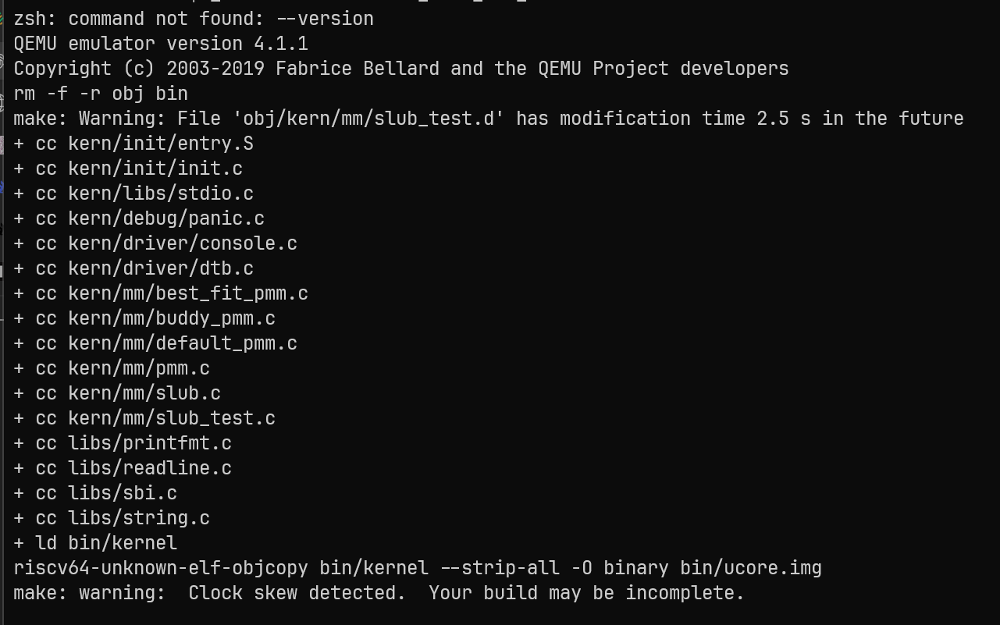
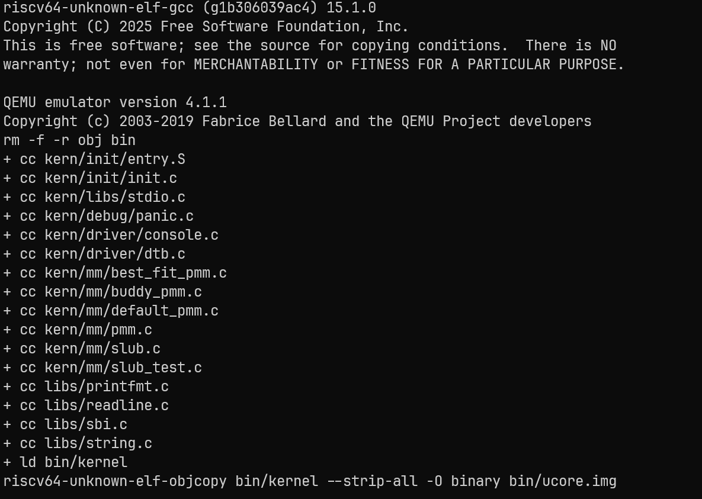
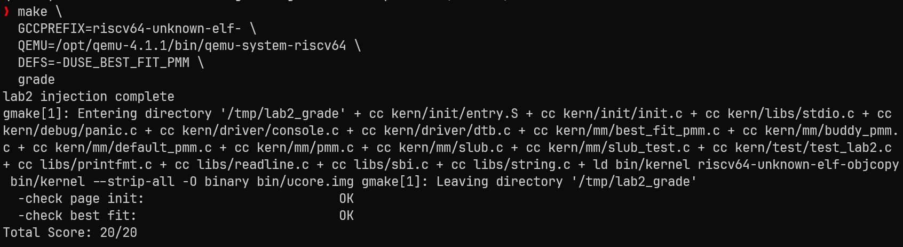

# 操作系统实验报告

## 实验基本信息

| 项目 | 内容 |
|------|------|
| **实验名称** | Lab 2：物理内存和页表 |
| **小组成员** | 2411046-梁家瑞、2412727-刘蔚霖、2411041-李培涛 |
| **完成日期** | 2026-10-22（成员 C 集成记录）；2026-10-26（成员 B 补充 QEMU 页表调试） |

### 小组分工

| 成员 | 负责的练习/模块 |
|------|----------------|
| 2411046-梁家瑞（成员 A） | `page_init()`、First-Fit 分析、Buddy System 及测试 |
| 2412727-刘蔚霖（成员 B） | Best-Fit、SLUB 及测试；双 GDB 调试 QEMU 页表查询、地址翻译和 TLB 填充 |
| 2411041-李培涛（成员 C） | 接口集成、构建验证、报告和交付检查 |

## 一、实验目的

本实验围绕物理内存的发现、初始化和分配展开，目标是：

1. 从设备树获取物理内存范围并建立 `Page` 描述符布局。
2. 理解 First-Fit 的连续物理页分配、释放和相邻块合并。
3. 在统一的 `pmm_manager` 接口下实现并接入 Best-Fit 和 Buddy System。
4. 在页级分配器之上实现 SLUB 任意大小对象分配。
5. 记录真实提示词、测试命令、验证证据和环境限制。
6. 通过双 GDB 观察 QEMU 模拟 MMU 的过程，把一次内核访存与页表查询、物理地址计算及 TLB 缓存联系起来。

## 二、实验环境

| 成员 | 环境与工具 | 验证边界 |
|------|------------|----------|
| 成员 A | Windows + WSL Ubuntu；目标为 RISC-V 64 | 具体工具版本以成员 A 记录为准 |
| 成员 B | macOS、`riscv64-elf-gcc 16.2.0`、QEMU 11.1.2；页表调试另用 Docker Ubuntu 24.04/aarch64、GCC 13.3.0、GDB 15.1、带符号的 QEMU 4.1.1 | 提供 Best-Fit、SLUB、课程评分及双 GDB 页表调试实测记录 |
| 成员 C | Windows + WSL Ubuntu 24.04、RISC-V GCC 15.1.0、QEMU 4.1.1 | 通过显式选择课程要求的 QEMU 版本后完成复核 |

代码目录为 `code/labcodes/lab2/lab2_new`，目标架构为 RISC-V 64，默认模拟物理内存为 128 MiB。本次成员协作使用的模型为 `gpt6-luna`；AI 工具名称未在本次交付中统一记录，不据此推断其他工具信息。

## 三、实验整体逻辑分析

### 3.1 逻辑主线

启动页表建立后，内核先由 `init_pmm_manager()` 选择页级物理内存管理器。`page_init()` 读取设备树提供的物理内存范围，设置 `va_pa_offset`、`npage` 和 `pages`，排除 OpenSBI、内核镜像、`Page` 描述符数组和对齐占用的页面，再通过 `init_memmap()` 注册完整空闲页。

上层通过统一的 `alloc_pages()`、`free_pages()` 和 `nr_free_pages()` 使用不同的页级算法。First-Fit 作为参考实现，Best-Fit 选择最小的可用空闲块，Buddy System 按二的幂次分裂和合并。SLUB 位于页级分配器之上，把页面切成固定规格对象；大对象则申请连续多页。

### 3.2 实现顺序

1. 设备树初始化提供物理内存基址和大小。
2. `page_init()` 建立可管理页面和初始空闲区。
3. 阅读 First-Fit，固定 `PageReserved`、`PageProperty`、`property` 和 `nr_free` 等状态约定。
4. 接入 Best-Fit 和 Buddy System，并保持 `pmm_manager` 接口一致。
5. 初始化 SLUB，验证小对象、大对象、对齐、复用和释放。
6. 集成三人的代码，检查报告、提示词、截图和生成物。

## 四、实验内容与实现

### 4.1 物理内存探测与 Page 描述符初始化

**负责人：** 2411046-梁家瑞

**涉及文件和函数：**

- `kern/mm/pmm.c`：`page_init()`、`pmm_init()`、`init_pmm_manager()`；
- `kern/driver/dtb.c`：`get_memory_base()`、`get_memory_size()`；
- `kern/mm/memlayout.h`：地址转换和页布局宏。

`page_init()` 先检查设备树范围是否有效，再设置虚实地址偏移和页数上界。`pages` 在内核 `end` 之后按页对齐；描述符数组的物理末端使用 `PADDR()` 计算，空闲起点向上对齐，设备树物理内存末端向下对齐。只有存在完整页面时才调用 `init_memmap()`。

成员 A 的记录覆盖了设备树无效、地址加法溢出、物理内存上界、描述符数组占用和空闲区不足一页等边界。成员 A 提供的实测截图见 [page_init 验证](./images/lab2-A-page-init.png)。

本模块的提示词记录见 `report/prompt.md` 的 Prompt A-1；该提示词只用于整理报告，没有生成或修改源码。

### 4.2 First-Fit 原理分析

**负责人：** 2411046-梁家瑞

`default_init()` 初始化空闲链表和 `nr_free`；`default_init_memmap()` 将连续页面登记为一个空闲块；`default_alloc_pages()` 从地址有序链表中选择第一个足够大的块并在必要时切分；`default_free_pages()` 插入释放区并合并相邻块。

First-Fit 实现简单，按地址排序也方便合并，但可能线性扫描空闲块并造成外部碎片。可选改进包括 Best-Fit、按大小分组的空闲链表和 Buddy System，各自需要在搜索开销、内部碎片、外部碎片和实现复杂度之间取舍。

First-Fit 的说明和改进分析与 `report/prompt.md` 的 Prompt A-1 一起记录。

### 4.3 Best-Fit 连续页分配器

**负责人：** 2412727-刘蔚霖

**涉及文件和函数：**

- `kern/mm/best_fit_pmm.c`：初始化、空闲区登记、最小可用块选择、切分、释放、合并和附加检查；
- `kern/mm/pmm.c`：默认选择 `best_fit_pmm_manager`，可用 `USE_FIRST_FIT_PMM`、`USE_BUDDY_PMM` 显式切换参考实现和扩展后端；
- `kern/mm/default_pmm.c`：修复尾部插入后缺少 `break` 的问题。

Best-Fit 遍历全部空闲块，选择满足请求的最小块；同尺寸候选保持地址较低者。分配时保留剩余块，释放时按地址插入并合并前后相邻块，`nr_free` 只按实际页数变化。

成员 B 的附加测试覆盖最小适配、同尺寸选择、切分、连续块不足、前后合并和链表计数。成员 B 记录的完整验证截图见 [Best-Fit 与 SLUB](./images/lab2-B-best-fit-slub.png) 和 [完整检查](./images/lab2-B-full-checks.png)。

**Best-Fit 算法的进一步改进空间（练习问题回答）：**

当前实现已保证 Best-Fit 的语义正确：总是选中满足请求的最小块，同尺寸候选取地址较低者，释放时按地址插入并合并前后相邻块，`nr_free` 始终等于空闲块页数之和。在此之上仍有以下改进空间：

1. 查找复杂度：`best_fit_alloc_pages()` 每次分配都线性遍历整个空闲链表，最坏为 O(n)。可以把空闲块按大小分桶（segregated free list）或用平衡树、跳表组织，把"找最小可用块"降到 O(log n) 甚至 O(1)，代价是合并和切分时需要同步维护辅助结构。
2. 碎片策略：Best-Fit 倾向于把块切成"刚好够用加很小的剩余"，长期运行会积累大量难以复用的小块。可以设置最小剩余阈值，当剩余块低于实用下限时改选更大的块（向 First-Fit 折中），或者对小块做延迟合并、定期整理。
3. 分配局部性：目前每次分配都从链表头扫描，可以缓存上次分配位置做滚动指针，同尺寸块优先选与上次分配相邻的地址，改善局部性。
4. 边界简化：`insert_free_block()` 手工处理空链表和尾部插入两种边界，改用带哨兵节点的循环链表写法可以去掉特判，减少出错面。

这些改进属于性能和鲁棒性范畴。实验手册对 Best-Fit 的时空复杂度不做要求，当前实现已通过框架的 `best_fit_check()`、成员 B 的附加检查和课程评分。

成员 B 的实现提示词和迭代记录见 `report/prompt.md`；成员 C 的集成与截图交付提示词见 `report/prompt.md` 的 Prompt C-1 和 Prompt C-2。

### 4.4 Buddy System

**负责人：** 2411046-梁家瑞

**涉及文件和函数：**

- `kern/mm/buddy_pmm.c`：`buddy_init()`、`buddy_init_memmap()`、`buddy_alloc_pages()`、`buddy_free_pages()`、`buddy_check()`；
- `kern/mm/buddy_pmm.h`：管理器声明；
- `kern/mm/pmm.c`：`USE_BUDDY_PMM` 选择路径。

Buddy System 使用不同阶次的空闲链表。初始化时把不一定按最大块对齐的区间分解成多个二的幂次块；分配时向上取整到目标阶次，从更高阶链表取得块后不断分裂；释放时通过相对页号异或定位伙伴，检查边界和阶次后逐级合并。

成员 A 的 `buddy_check()` 覆盖 1、3、8 页请求、分裂、耗尽失败、不同释放顺序、两级伙伴合并、释放后重新分配和空闲页计数恢复。实测截图见 [Buddy 检查](./images/lab2-A-buddy-check.png)。

Buddy System 的两份提示词（模块生成与测试设计）见 `report/prompt.md` 的 Prompt A-4 和 Prompt A-5，并在临时副本上实际执行验证，生成的模块和测试可正常编译运行；Prompt A-2 和 A-3 只用于整理报告说明结构，不生成代码。

### 4.5 SLUB 任意大小对象分配

**负责人：** 2412727-刘蔚霖

**涉及文件和函数：**

- `kern/mm/slub.c`：cache、slab、对象分配、对齐、释放和大对象路径；
- `kern/mm/slub.h`：`slub_init()`、`kmalloc()`、`kmalloc_aligned()`、`kfree()`、`slub_check()`；
- `kern/mm/slub_test.c`：正常路径、耗尽和非法释放测试；
- `kern/init/init.c`：初始化后调用 SLUB 自检。

小对象使用 16 至 2048 字节的规格 cache。每个 slab 从页级分配器取得页面，将元数据、对齐填充和对象槽位放在页面中；空闲对象通过链表和位图管理。释放对象时恢复槽位，空 slab 归还后端页面。超过小对象规格的请求使用连续多页，并检查溢出、对齐和空间不足。

成员 B 的自检覆盖 30 种大小、跨 slab 分配、释放复用、对齐、大对象、算术溢出、真实耗尽和五类非法释放。课程评分截图见 [Lab2 grade](./images/lab2-B-grade.png)。

SLUB 的实现、测试和错误路径提示词记录见 `report/prompt.md`。

### 4.6 成员 C：联调、验证与交付整理

**负责人：** 2411041-李培涛

成员 C 没有重复实现成员 A、B 已完成的分配算法，主要负责把三人的工作放到同一份 `lab2` 代码基线上，并用实际运行结果确认它们能够共同工作。

#### 代码与接口联调

1. 拉取远程 `lab2` 分支的最新提交，核对成员 A 的 `page_init()`/Buddy System 与成员 B 的 Best-Fit/SLUB 是否同时存在。
2. 梳理 `pmm_init()` → `init_pmm_manager()` → `page_init()` → `init_memmap()` → `alloc_pages()`/`free_pages()` 的调用链，确认三种页级后端都遵守 `pmm_manager` 接口。
3. 检查 `pmm.c` 的后端选择（默认 Best-Fit，`USE_FIRST_FIT_PMM`、`USE_BUDDY_PMM` 显式切换）、SLUB 初始化入口和 Makefile 的编译参数，避免一个后端的改动覆盖其他后端。
4. 检查构建生成物和临时文件的忽略规则，避免 `bin/`、`obj/`、日志等文件进入交付目录。

#### 构建和运行验证

成员 C 在 WSL2 中选择 QEMU 4.1.1 并加载 RISC-V 工具链后执行：

```sh
make clean
make GCCPREFIX=riscv64-unknown-elf- DEFS=-DUSE_BEST_FIT_PMM
make GCCPREFIX=riscv64-unknown-elf- QEMU=qemu-system-riscv64 DEFS=-DUSE_BEST_FIT_PMM qemu
make GCCPREFIX=riscv64-unknown-elf- QEMU=qemu-system-riscv64 DEFS=-DUSE_BEST_FIT_PMM grade
python3 tools/check_member_b.py \
  --gccprefix riscv64-unknown-elf- \
  --qemu qemu-system-riscv64 \
  --timeout 30
```

验证结果为：

- 内核成功编译并生成镜像；
- QEMU 启动后输出 `best_fit_pmm_manager`，Best-Fit 检查和四组 SLUB 自检均为 `PASS`；
- `make grade` 输出 `page init: OK`、`best fit: OK` 和 `Total Score: 20/20`；
- 自动验证脚本覆盖 Best-Fit、First-Fit、Buddy 三种后端，以及五类非法释放路径，全部通过。

成员 C 的三张复核截图如下，分别记录构建、QEMU/SLUB 自检和课程评分：







#### 报告和交付整理

1. 将成员 A、B 的阶段报告合并为 `report/report.md`，补齐实验目的、整体逻辑、模块接口、Challenge、测试结果和限制说明。
2. 汇总成员 A、B 的实际提示词和协作迭代，并补充成员 C 的集成、验证和截图交付提示词，统一保存在 `prompt.md`。
3. 检查 `report/images/` 中的截图文件与 Markdown 链接一一对应，保留截图来源和验证边界。
4. 执行 `git diff --check`、`git status` 和分支/远程核对，提交并推送最终 `lab2` 分支。

成员 C 的交付重点是让算法实现、测试证据、报告和 Git 分支形成可复核闭环；算法正确性结论仍以成员 A、B 的代码和三人共同复跑的测试结果为依据。

### 4.7 Challenge：未知硬件的可用物理内存范围

**负责人：** 2411046-梁家瑞

操作系统通常通过固件或引导程序提供的硬件描述获得内存布局。RISC-V 可解析设备树 `memory` 节点，其他平台可使用 BIOS E820、UEFI memory map 或 ACPI。内核获得范围后还要扣除固件、内核镜像、设备保留区、内存映射 I/O 和自身元数据。若平台完全没有描述接口，破坏性探测不应作为通用操作系统的首选方案。

### 4.8 分支任务：双 GDB 调试 QEMU 页表查询过程

**负责人：** 2412727-刘蔚霖。**实测日期：** 2026-10-26。

#### 目的与两个调试器的关系

本任务观察 CPU 执行访存指令时，虚拟地址如何变成物理地址。真实机器由 MMU 完成这些步骤；本实验在 QEMU 中运行内核，能通过 QEMU 的 C 源码观察模拟实现。

- **内层 `gdb-multiarch`**：通过 QEMU 的 gdbstub（端口 1234）调试 RISC-V 内核，停在一条真实的栈写指令前，并单步执行它。
- **外层原生 `gdb`**：调试运行在 Linux/aarch64 上的 QEMU 进程，在 MMU 查表和软件 TLB 填充函数中记录状态。

外层暂停 QEMU 时，内层 GDB 的单步命令会等待；只有外层继续运行 QEMU，内层指令才能执行完。这就是“调试正在调试 ucore 的 QEMU”。只在内核中打印 SATP 或手工算地址，不能替代这一层源码观察。

本次使用 QEMU **4.1.1** 源码，开启调试信息并以 `-O0` 构建。没有修改 QEMU 的地址翻译算法，也没有修改内核分配器。内核基线为 `e7490ca`，使用 Best-Fit 配置编译。构建配方、双 GDB 脚本和复现说明保存在 [tools/pagewalk](../code/labcodes/lab2/lab2_new/tools/pagewalk/README.md)。

#### 选取的访存指令

先断到 `kern_init`，再通过反汇编找到其第一条 `sd ra,8(sp)`。实际记录如下：

```text
=> 0xffffffffc02000ec <kern_init+22>: sd ra,8(sp)
pc   = 0xffffffffc02000ec
sp   = 0xffffffffc0205ff0
ra   = 0x80000a02
satp = 0x8000000000080206
```

这条指令把 RA 的 8 字节内容写到 `sp + 8`，因此目标**数据虚拟地址**为 `0xffffffffc0205ff8`。注意它与指令自身所在的 PC 是两个地址。

在外层 GDB 中实际捕获到以下调用链（由上层调用者向内排列）：

```text
TCG 生成的代码
  -> helper_le_stq_mmu
  -> store_helper
  -> tlb_fill
  -> riscv_cpu_tlb_fill
  -> get_physical_address
```

`access_type = 1`（store）、`mmu_idx = 1`（本次为 S-mode）。因此该记录来自 CPU 的真实写操作；调试器自身读内存触发的翻译被过滤，没有混入 store 查表计数。

#### SATP、页表索引和物理地址

外层 GDB 在 `target/riscv/cpu_helper.c:256` 停到 PTE 已读出的状态，并记录以下值；翻译返回结果由 GDB 的函数返回断点获取：

| 观测项 | 实测结果及含义 |
|---|---|
| SATP | `0x8000000000080206`，MODE=8，即 Sv39；ASID=0 |
| 根页表物理地址 | SATP 的 PPN `0x80206` 左移 12 位，得到 `0x80206000` |
| 根页表虚拟地址 | `boot_page_table_sv39 = 0xffffffffc0206000` |
| VA 分解 | VPN[2]=511、VPN[1]=1、VPN[0]=5、页内偏移=`0xff8` |
| 本次访问的层级 | QEMU 循环变量 `i=0`、`ptshift=18`，即首先查询的 Sv39 顶层 |
| 本层索引 | `idx=511` |
| PTE 物理地址 | `0x80206000 + 511 × 8 = 0x80206ff8` |
| PTE 值 | `0x200000cf`，PPN=`0x80000` |
| PTE 标志 | V、R、W、X、A、D 为 1；U、G 为 0 |
| 翻译函数返回 | `result=0`（成功），`*physical=0x80205000`，`*prot=7`（读、写、执行） |
| 最终数据物理地址 | `0x80205000 + 0xff8 = 0x80205ff8` |

**为什么没有查完三级？** Sv39 允许在不同层级放叶子项。当前 `entry.S` 的根表第 511 项已经有 R/W/X 权限，是一个覆盖 **1 GiB** 的叶子项，故第一层查询就结束。只有遇到有效且 R/W/X 都为 0 的非叶子项，才继续到下一级。不能把“采用 Sv39”解释成每次一定读三张页表。

本次 1 GiB 大页的完整地址计算为：

```text
物理大页基址 = PTE.PPN << 12 = 0x80000000
大页内偏移   = VA & ((1 << 30) - 1) = 0x205ff8
物理地址     = 0x80000000 + 0x205ff8 = 0x80205ff8
```

QEMU 的 `get_physical_address` 在该路径返回的是 4 KiB 对齐的物理页地址 `0x80205000`；最终字节地址还包含低 12 位偏移。把这个返回值直接当成此次 store 的完整物理地址，会少算 `0xff8`。

#### TLB 填充与第二次访问

外层 GDB 在 `tlb_set_page` 和 `accel/tcg/cputlb.c:836`（TLB 项复制完成之后）记录到：

```text
vaddr = 0xffffffffc0205000
paddr = 0x80205000
prot = 7, mmu_idx = 1, size = 4096
TLB index = 5
addr_read = addr_write = addr_code = 0xffffffffc0205000
```

这里页表中的映射覆盖 1 GiB，而本版 QEMU 此调用向软件 TLB 填入的是当前访问对应的 4 KiB 页。软件 TLB 还保存宿主内存地址换算所需的 `addend`，它会受宿主进程地址布局影响，不应误当成 RISC-V 的物理页号。

内层 GDB 执行一次 `si` 后，把 PC 放回同一条 `sd` 再执行一次。它是为了对照而**人为重放的同值栈写操作**，不是内核自然重复执行。两次 PC 均从 `0xffffffffc02000ec` 前进到 `0xffffffffc02000ee`，虚拟地址中的值均为 RA。外层共捕获到 **一次目标 store 查表、一次 PTE 读取和一次 TLB 填充**。结合已填入的有效写标签与两次完成的 store，说明第二次访问复用了缓存，没有再次走页表查询路径。

随后通过 QEMU 的 `Qqemu.PhyMemMode:1` 调试扩展直接读取物理地址，得到真实终端记录：

```text
STORE 1: VA=0xffffffffc0205ff8 value=0x80000a02
STORE 2: VA=0xffffffffc0205ff8 value=0x80000a02
sending: Qqemu.PhyMemMode:1
received: "OK"
PHYSICAL: PA=0x80205ff8 value=0x80000a02
sending: Qqemu.PhyMemMode:0
received: "OK"
```

这使页表公式、QEMU 翻译结果和实际物理内存中的写入值相互对应。恢复虚拟地址调试模式并脱离内层 GDB 后，内核继续启动，Best-Fit 附加检查和全部 SLUB 自检通过。

#### 复现与验证边界

在已准备好 Linux 调试环境、带符号 QEMU 和编译后的内核时执行：

```sh
python3 tools/pagewalk/run.py \
  --qemu /opt/qemu-build/riscv64-softmmu/qemu-system-riscv64 \
  --source /opt/qemu-src --kernel-dir "$PWD" --out /tmp/pagewalk-new-run
```

完整 Docker 构建和运行步骤见上述 README。脚本记录两层 GDB 的真实输出与结构化观测值，核对地址计算、权限、TLB 标签、写入值、两次访存的查表次数以及最终内核自检；本次输出 `result: PASS`、`stores: 2`、`walks: 1`、`levels_visited: 1`、`kernel_self_checks: PASS`。原始日志保留在仓库外，报告摘录实际结果，不将生成日志或伪造截图作为提交物。

结论范围是**当前内核的顶层大页映射、一次写访问及其受控重放**。没有把它扩展成已验证三级非叶子遍历、所有权限异常或真实 CPU 硬件 TLB 行为；这里观察的是 QEMU 4.1.1 的软件模拟实现。

源码依据：[RISC-V 地址翻译及 TLB fill](https://github.com/qemu/qemu/blob/v4.1.1/target/riscv/cpu_helper.c)、[TCG 软件 TLB](https://github.com/qemu/qemu/blob/v4.1.1/accel/tcg/cputlb.c)。

## 五、集成、测试与验证

### 5.1 成员 B 提供的已完成验证

成员 B 记录了以下本机实测：

| 测试 | 结果来源 |
|------|----------|
| Best-Fit + SLUB | 成员 B 终端截图和 `prompt.md` 记录为 PASS |
| First-Fit + SLUB | 成员 B 自动验证记录为 PASS |
| Buddy + SLUB | 成员 B 自动验证记录为 PASS |
| 非法释放路径 | 预期 `panic`，成员 B 记录为通过 |
| 课程评分 | `make ... grade` 记录为 20/20，见 [评分截图](./images/lab2-B-grade.png) |
| QEMU 页表查询分支任务 | 2026-10-26 双 GDB 实测：地址翻译、TLB 填充、重复访问及物理内存写入核对通过，详见 4.8 节 |

这些结论最初由成员 B 提供环境和截图；成员 C 随后在 WSL2 中使用课程要求的 QEMU 4.1.1 和 RISC-V 工具链重跑了同一套检查，结果一致。

### 5.2 成员 C 当前环境验证

成员 C 在 WSL2 Ubuntu 24.04 选择 QEMU 4.1.1 并加载 RISC-V 工具链后执行了：

```sh
make
make qemu
make grade
```

构建成功生成内核镜像；`make qemu` 输出设备树物理内存范围、`best_fit_pmm_manager`、Best-Fit 检查和四组 SLUB 自检均为 `PASS`。课程评分命令输出 `page init: OK`、`best fit: OK` 和 `Total Score: 20/20`。上述命令无需附加编译宏：`pmm.c` 已将 Best-Fit 设为默认页级分配器，`USE_FIRST_FIT_PMM`、`USE_BUDDY_PMM` 只用于显式切换后端做对照测试。在此之前普通 `make grade` 实际运行 First-Fit、评分为 10/20，该问题已在集成阶段修正并复测。自动验证脚本另外报告以下结果：

- Best-Fit + SLUB：PASS；
- First-Fit + SLUB：PASS；
- Buddy + SLUB：PASS；
- 小对象内部地址、重复释放、外来地址、大对象内部页和大对象重复释放：均按预期触发 `panic`；
- course grade：20/20。

### 5.3 交付检查

- 当前分支为 `lab2`，远程跟踪 `origin/lab2`。
- `bin/`、`obj/`、日志和其他本地生成物已加入忽略规则。
- 报告引用的 lab2 图片均位于 `report/images/`。
- A、B 的阶段报告内容已合并到本报告，A、B、C 的提示词记录集中在 `prompt.md` 中。
- 代码和报告的最终构建、QEMU、课程评分及成员 B 全套检查均已在 WSL2 完成。

## 六、实验总结与收获

本实验把物理内存从设备树描述转换为可管理的 `Page` 资源，再用统一接口替换不同分配策略。First-Fit 展示了连续空闲块链表的基本语义；Best-Fit 改变了选块策略；Buddy System 通过二的幂次分裂和合并改善了伙伴定位；SLUB 则在页级分配之上提供对象级复用。

实现过程中最重要的不变量包括：保留页不能进入空闲区，空闲块头的 `property` 必须与链表状态一致，`nr_free` 必须等于所有空闲块页数之和，SLUB 释放时不能接受对象内部地址或重复释放。成员 B 的测试还说明，页级课程评分不能代替 SLUB 的对象级和非法释放测试。

成员 B 补充的双 GDB 调试把“分配内存”和“访问内存”两个问题连起来：分配器负责给出可使用的页面或对象；MMU 根据页表翻译访问地址，TLB 缓存翻译结果。实际观察还纠正了“Sv39 每次一定查三级”的误解：当前启动页表使用顶层 1 GiB 叶子映射，本次只读取一个 PTE。

本次集成在 WSL2 中完成了课程构建、QEMU、grade 和成员 B 全套检查。仍需注意该实现是单核教学版本，报告只把成员 A/B 的截图和成员 C 的实际终端输出分别作为证据，不用课程 grade 代替 SLUB 的对象级测试。
