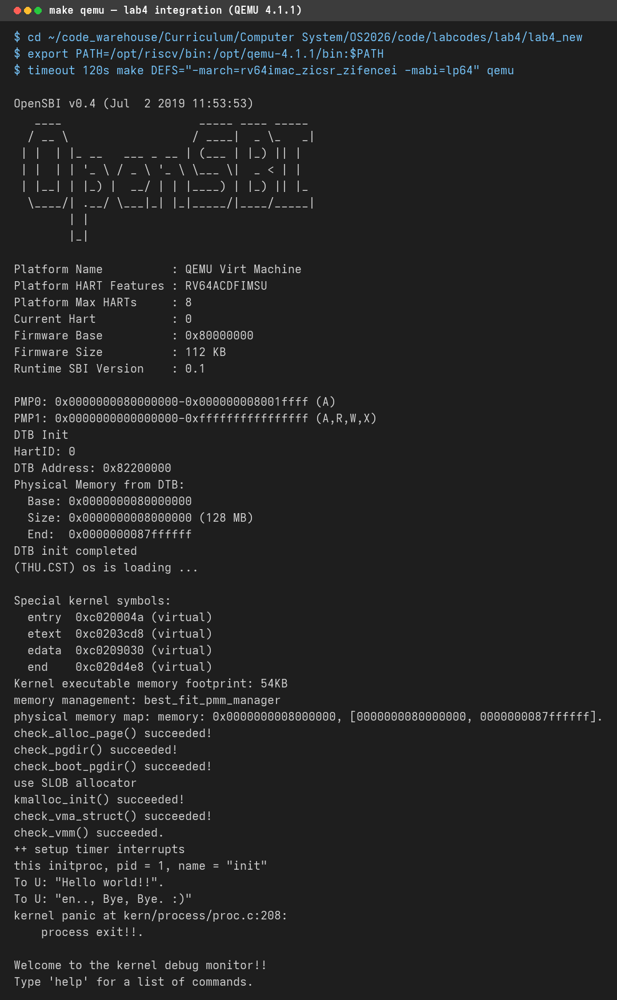
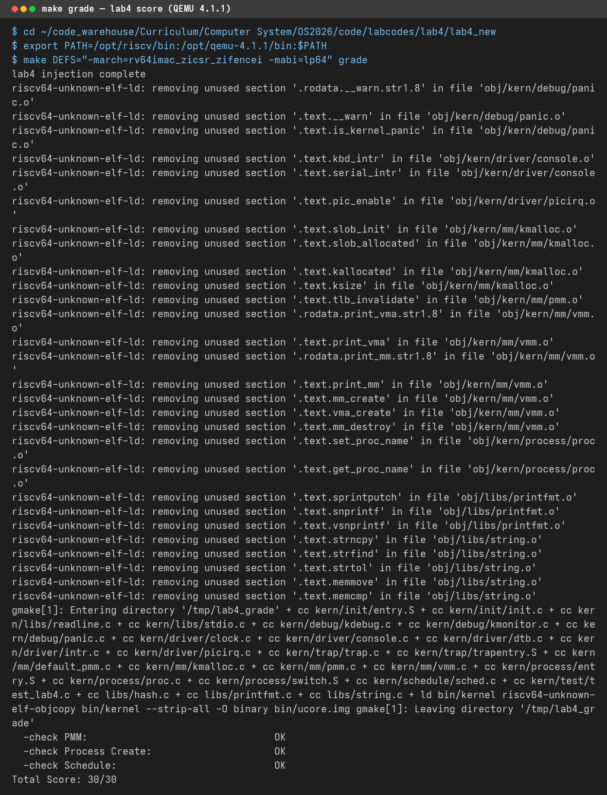

# 操作系统实验报告

## 实验基本信息

| 项目 | 内容 |
|------|------|
| **实验名称** | Lab 4:进程管理 |
| **小组成员** | 2411046-梁家瑞、2412727-刘蔚霖、2411041-李培涛 |
| **完成日期** | 2026-11-13(骨架导入与分工确认);2026-11-16(三模块合入,集成验收通过) |

### 小组分工

| 成员 | 负责的练习/模块 |
|------|----------------|
| 2411046-梁家瑞(成员 A) | 功能模块一:虚拟内存页操作(`kern/mm/pmm.c` 的 `page_insert()`、`page_remove()`);Challenge 2(`get_pte()` 与 sv32/sv39/sv48 分页模式思考题、查找与分配是否拆分) |
| 2412727-刘蔚霖(成员 B) | 功能模块二:进程创建及初始化(`kern/process/proc.c` 的 `alloc_proc()`、`proc_init()`、`kernel_thread()`、`do_fork()`、`copy_thread()`、`copy_mm()`) |
| 2411041-李培涛(成员 C) | 功能模块三:进程调度(`kern/process/proc.c` 的 `cpu_idle()`、`proc_run()`,`kern/schedule/sched.c` 的 `schedule()`,`kern/process/switch.S` 的 `switch_to()`);Challenge 1(`local_intr_save`/`local_intr_restore` 开关中断机制);接口集成与联调验证(骨架中的 lab2/lab3 迁移由成员 C 预置,复核与 `make qemu`/`make grade` 最终联调归成员 C)、报告汇总交付 |

实验报告分工:各成员撰写本人负责模块的功能描述、最终提示词与实现迭代过程;成员 C 汇总实验整体逻辑分析、测试验证与实验总结。

---

## 一、实验目的

1. 理解虚拟内存管理的基本结构,掌握虚拟内存的组织与管理方式(vmm 与预映射式地址空间)。
2. 理解内核线程创建/执行的管理过程,掌握进程控制块 `struct proc_struct` 的字段含义与生命周期状态。
3. 掌握内核线程的切换和基本调度过程,理解 `context`/`trapframe` 两级现场与 `forkret → forkrets → __trapret` 首次运行链路。
4. 继续使用 AI 辅助开发,记录提示词迭代、实现问题和验证证据。

---

## 二、实验环境

| 成员 | 环境与工具 | AI 编程工具与模型 |
|------|------------|-------------------|
| 成员 A | OS2026 工程、RISC-V 64、`riscv64-unknown-elf-` 工具链、QEMU 4.1.1 | Codex,底层模型 gpt-6.1-sol;AI 仅用于阅读源码、报告结构整理与文字润色,不生成核心实验代码 |
| 成员 B | macOS、`riscv64-elf-gcc 16.2.0`、QEMU 11.1.2 | Codex,底层模型 gpt-6.1-sol |
| 成员 C | Fedora、`riscv64-unknown-elf-gcc 15.1.0`、QEMU 4.1.1(本地 `/opt/qemu-4.1.1`) | ZCode(终端 Agent),底层模型 GLM-5.3 |

代码目录:`code/labcodes/lab4/lab4_new`,目标架构 RISC-V 64。

---

## 三、实验整体逻辑分析

### 3.1 本章节的逻辑主线

Lab4 在 Lab3 的 Trap 机制上继续实现进程管理。整体分为三层:

1. 虚拟内存页操作:利用页表建立和撤销线性地址到物理页的映射;
2. 进程创建及初始化:用 PCB、内核栈、TrapFrame 和 Context 描述内核线程;
3. 进程调度与切换:选择可运行线程并保存、恢复 Context。

执行链为 `kern_init → pmm_init(建立 boot_pgdir,自测 check_pgdir/check_boot_pgdir) → pic_init/idt_init → vmm_init → proc_init(创建 idleproc 与 initproc) → cpu_idle → schedule → proc_run → switch_to`;前半段把地址空间准备好,后半段让第一个可运行线程真正跑起来。

页映射是后续进程创建的基础,页表根地址、内核栈和进程地址空间都依赖正确的页管理:如果引用计数错误,后续回收可能出现悬空页或重复释放;如果修改页表后不刷新 TLB,CPU 可能继续使用旧翻译。

### 3.2 功能的逐步实现

三个模块按依赖顺序实现:

1. 先做页操作。`get_pte` 负责定位页表项并按需创建中间页表,`page_insert`/`page_remove` 负责改变叶子 PTE 与物理页引用关系。没有正确的页映射,后续进程创建无法安全分配内核栈与页表。
2. 再做进程创建。`proc_init → kernel_thread → do_fork → alloc_proc/setup_kstack/copy_mm/copy_thread` 组合出完整的 PCB 与两级现场(TrapFrame 保存完整异常返回现场,Context 只保存调用约定要求的被调用者保存寄存器),线程被登记进进程链表,处于可运行状态但尚未执行。
3. 最后做调度。`schedule` 选出下一个可运行线程,`proc_run` 在关中断临界区内完成 current 更新、页表切换与 `switch_to` 现场迁移;新线程第一次运行经 `forkret → forkrets → __trapret` 链路进入预定入口。

页操作的调用关系:

```text
线性地址 la
  -> get_pte(pgdir, la, create)   得到目标 PTE
  -> page_insert / page_remove    更新 PTE 和 Page.ref
  -> tlb_invalidate               让处理器看到最新页表内容
```

---

## 四、实验内容与实现

### 功能模块一:虚拟内存页操作

**负责人:** 2411046-梁家瑞

**需要实现/修改的函数:**

```c
int page_insert(pde_t *pgdir, struct Page *page, uintptr_t la, uint32_t perm);(kern/mm/pmm.c)
void page_remove(pde_t *pgdir, uintptr_t la);(kern/mm/pmm.c)
```

**功能说明:** 在现有多级页表框架上完成最基本的映射维护:把物理页挂到指定线性地址上、把已有映射安全撤销。关键约束是保持"页表项内容、物理页引用计数、TLB 状态"三者同步:`page_insert` 需正确处理原地址已映射到同一物理页/其他物理页两种情况,失败时返回 `-E_NO_MEM` 且不留半完成映射;`page_remove` 是幂等删除接口,目标地址无映射时安静返回。依赖 `get_pte()`、`pte_create()`、`pte2page()`、`page_ref_inc()`/`page_ref_dec()`、`set_page_ref()`、`tlb_invalidate()` 等接口与 `PTE_V/PTE_U/PTE_W/PTE_R` 权限位宏。

#### 最终提示词

成员 A 的核心代码依据工程现有接口(`get_pte`、`check_pgdir`、`pmm.h` 等)手写实现,AI 仅用于阅读源码与实验要求、梳理函数调用关系、检查报告结构和润色文字,不生成核心实验代码。报告整理使用的四段式提示词见 `prompt.md` 的"Prompt A:成员 A 报告整理 Prompt"章节。

#### 实现迭代过程

**(1)设计依据:Sv39 页表与 get_pte。** 本工程使用 Sv39 风格的三级页表,有效虚拟地址由三个 9 位 VPN 和 12 位页内偏移组成(`VPN[2]/VPN[1]/VPN[0]/offset`,对应宏 `PDX1/PDX0/PTX/PGOFF`);页表页 4096 字节、页表项 8 字节,每页 512 个页表项。`get_pte(pgdir, la, create)` 的流程:用 `PDX1(la)` 定位根页表一级项,无效且 create 为真时分配下一级页表;再用 `PDX0(la)` 定位第二级项,无效且 create 为真时再分配页表页;最后用 `PTX(la)` 定位叶子 PTE 返回。create 为 0 且中间页表不存在时返回 NULL,不产生分配副作用。

**(2)page_insert 实现。** 把物理页 page 映射到线性地址 la 并设置权限 perm:

1. `get_pte(pgdir, la, 1)` 获取目标 PTE,失败返回 `-E_NO_MEM`;
2. 若目标已有有效映射,取出旧物理页:旧页就是新页时只更新权限,不改变引用计数(映射数量未变,只是权限变化);
3. 旧页不同时先 `page_remove` 删除旧映射;
4. 对新页 `page_ref_inc`,用 `pte_create(page2ppn(page), perm)` 写入新 PTE,`tlb_invalidate` 后返回 0。

**(3)page_remove 实现与集成修复。** 撤销线性地址 la 的有效映射:`get_pte(pgdir, la, 0)` 查询(create=0,保证幂等,对无映射地址安静返回,连续删除不会重复减引用);PTE 有效时取旧物理页,清零 PTE、`tlb_invalidate`、`page_ref_dec`,引用计数归零时调用 `free_page` 将物理页归还空闲列表。

初版实现只在解除映射时递减引用计数,引用计数归零时不释放物理页,理由是"解除一个映射不等于物理页生命周期结束"。集成验收证明该理解与 uCore 的引用计数约定不符:`check_pgdir` 中 `p1`、`p2` 两个测试页解除映射后未归还,结尾的空闲页数守恒断言 `nr_free_store == nr_free_pages()` 失败,内核 panic。在该约定下 `Page.ref` 归零即表示该物理页不再被任何虚页映射、也无调用者持有,必须 `free_page` 归还;引用计数大于零时仅解除本条映射。已按标准语义修复(详见"五、测试与验证"的集成验收小节)。

**(4)实现约束(Spec)。** 前置条件:物理页分配器、`struct Page`、页表宏和 `get_pte` 已存在;`pgdir` 是有效页表根;`page` 是可用物理页。后置条件:插入成功时 la 的有效 PTE 指向 page 且权限等于 perm、引用计数正确;删除后 la 无有效映射、旧页引用减一;中间页表分配失败返回 `-E_NO_MEM`,不留半完成叶子映射;页表修改后旧地址翻译失效。测试用例覆盖:空地址建映射、一页多映射、新页替换旧页、同页同址改权限引用计数不变、删除有效/不存在映射、分配失败路径、删除后再插入。

**(5)实现风险与处理。** 同一物理页重复映射导致引用计数多加:检测旧 PTE 指向页是否就是新页,相同则只更新权限;替换旧页遗留旧映射:先 `page_remove` 再写入新 PTE;查询函数意外创建页表:`page_remove` 使用 create=0;CPU 使用旧 TLB:建立、替换、删除后均调用 `tlb_invalidate`;引用计数归零不释放物理页:即第 (3) 点记录的集成缺陷,已修复。

**(6)验证覆盖。** 工程内 `check_pgdir`、`check_boot_pgdir` 与评分注入的 `test_lab4_pmm_basic` 覆盖:建立映射后经 `get_pte` 能找到目标页、一页多映射、新页替换旧页、同页同址改权限引用计数不增加、删除映射后引用计数恢复、重复删除不出错、`PTE_U`/`PTE_W` 权限正确写入、页表更新后 TLB 失效、空闲页数守恒。最终整机结果见"五、测试与验证"。

---

### 功能模块二:进程创建及初始化

**负责人:** 2412727-刘蔚霖

**需要实现/修改的函数:**

```c
static struct proc_struct *alloc_proc(void);(kern/process/proc.c)
void proc_init(void);(kern/process/proc.c)
int kernel_thread(int (*fn)(void *), void *arg, uint32_t clone_flags);(kern/process/proc.c)
int do_fork(uint32_t clone_flags, uintptr_t stack, struct trapframe *tf);(kern/process/proc.c)
static void copy_thread(struct proc_struct *proc, uintptr_t esp, struct trapframe *tf);(kern/process/proc.c)
static int copy_mm(uint32_t clone_flags, struct proc_struct *proc);(kern/process/proc.c)
```

**功能说明:** 把系统从"已经能运行内核代码"推进到"已经能创建并登记多个内核线程"。`alloc_proc` 返回干净 PCB;`proc_init` 把当前执行现场包装成 `idleproc` 并创建第一个内核线程 `initproc`;`kernel_thread` 把函数入口和参数整理成线程首次运行所需的临时上下文;`do_fork` 组合内核栈、PID、链表与状态位等资源并处理失败清理;`copy_thread` 把 trapframe 和 context 安放到新线程内核栈上;`copy_mm` 在本实验承担地址空间处理的占位形态。完成后系统至少存在 `idleproc` 与 `initproc` 两个关键线程。

#### 提示词与实际协作记录

见 [Prompt B](prompt.md#member-b-prompt)。该提示词在实现提交后补充，用于后续手写练习；本次实际由 Codex 实现核心代码，协作过程已在同节说明。

#### 实现迭代过程

成员 B 已实现六个函数,以下验收清单为逐函数的实现要点与验证范围:

| 函数 | 实现要点 | 验证范围 |
|------|----------|----------|
| `alloc_proc` | 整块清零,pid=-1,PROC_UNINIT,pgdir=`boot_pgdir_pa`,链表节点自环;注入 kmalloc 失败返回 NULL | 宿主实测 |
| `proc_init` | 初始化全局链表和哈希桶;idle PID 0,启动栈、need_resched=1、current、计数 1;创建并查找 init PID 1,设置名称,失败 panic | 正常路径宿主实测,panic 路径代码检查 |
| `kernel_thread` | s0 存函数、s1 存参数;SPP/SPIE=1、SIE=0;epc=`kernel_thread_entry` | 字段实测与汇编核对 |
| `copy_thread` | 288 字节陷阱帧位于 8192 字节栈顶;16 字节对齐;a0=0;默认 sp 指向陷阱帧;显式 stack 被保留 | 宿主实测 |
| `do_fork` | 数量上限、PCB/栈分配、父子关系、发布顺序、PID 与计数 | 成功及两种分配失败实测 |
| `copy_mm` | 断言 current->mm==NULL,子 mm=NULL;不复制用户空间 | 正常路径实测;约束代码检查 |
| 首次执行 | context.ra=`forkret`、context.sp=tf;后续由模块三的切换恢复 | 字段验证通过;真实 CPU 执行已在集成后经 `make qemu`/`make grade` 验证(见第五节) |

概要流程:`alloc_proc` 清零 PCB(进程控制块),设置未初始化态、无效 PID、共享内核页表物理地址,并初始化两个链表节点;`proc_init` 将启动现场包装成 PID 0 的 idleproc,再通过 kernel_thread 创建 PID 1 的 initproc;`kernel_thread` 依照 entry.S 将函数和参数放入 s0/s1,设置 SPP/SPIE 并清除 SIE;`copy_thread` 将 trapframe(陷阱帧)复制到独立内核栈顶,设置子线程 a0=0 和 forkret 入口;`copy_mm` 明确断言父线程没有用户地址空间;`do_fork` 在资源准备完成后关中断分配 PID、登记哈希/链表、计数并唤醒,分配失败只回收已取得的资源。

**关键设计约定。** idle 不进入普通进程链表或 PID 哈希,`find_proc` 只接受正 PID;idle 计入 `nr_process`,调度器无普通可运行线程时以 idle 保底。所有线程共享内核页表,`pgdir` 保存物理地址而非 satp 编码,模块三切换时必须使用 Sv39 编码,不可调用 Sv32 遗留 `lsatp`。

**创建到首次运行的链路。** `proc_init → kernel_thread → do_fork → alloc_proc/setup_kstack/copy_mm/copy_thread → 分配 PID、挂接、计数、wakeup_proc`,初始化期间 current 始终为 idle。集成后 `switch_to` 恢复 context.ra/sp 进入 `forkret`;`forkrets` 将 sp 指向 current->tf;`__trapret` 恢复寄存器和 CSR,sret 根据 SPP 进入 S 模式、根据 SPIE 恢复中断;epc 指向 `kernel_thread_entry`,该入口把 s1 搬到 a0 并 `jalr s0` 执行线程函数(如 init_main)。函数返回后进入 `do_exit`,当前骨架的 `do_exit` 会 panic,这是预期终点而非完整退出回收实现。Context 只保存调用约定要求的返回地址、栈和被调用者保存寄存器,trapframe 保存完整异常返回现场,这是两种不同用途的保存层次。

**失败回滚与发布顺序。** 达到 MAX_PROCESS 返回 `-E_NO_FREE_PROC`;PCB 分配失败返回 `-E_NO_MEM`;栈分配失败释放 PCB;copy_mm 将来若返回错误,先释放栈再释放 PCB(当前 copy_mm 只有成功或断言失败,该错误分支为后续扩展保留,未声称已注入测试)。所有可失败步骤在挂接前完成,避免失败留下半个进程;发布阶段关中断,先挂接再唤醒。本实验单核、无创建过程抢占。`set_proc_name` 原接口固定复制 15 字节,idle/init 名称使用足够长的静态数组,避免从短字符串字面量越界读取。

**本地隔离验证(集成前,2026-11-13)。** 在 `code/labcodes/lab4/lab4_new` 运行 `python3 tools/check_member_b.py`,输出 `member B: PCB, init, publication, trapframe, PID and allocation rollback PASS`。脚本读取实际 proc.c、proc.h、trap.h、list.h,在临时目录编译运行,只替换内存分配、CSR、中断和汇编入口等外部依赖;分配器先填 0xa5 防止零内存掩盖初始化缺失,检查失败前后资源计数和链表不变,唤醒替身验证线程已登记。该脚本不执行 RISC-V 指令,不证明页表或调度正确;集成前的整机构建因模块一/三未合入而链接失败,未获得整机 QEMU 输出,三模块合入后的整机验证见第五节集成验收。

**实际修正。** 隔离测试初版的 static_assert 与宿主头文件重名,增加 undef;增强评分断言时补上 riscv.h;注入编译发现原测试线程返回 void 与 kernel_thread 的 int 返回值接口不符,修正测试函数签名并补不可达 `return 0` 以满足返回值检查(死循环行为不变)。没有修改评分标准或降低断言。


---

### 功能模块三:进程调度

**负责人:** 2411041-李培涛

**需要实现/修改的函数:**

```c
void cpu_idle(void);(kern/process/proc.c)
void schedule(void);(kern/schedule/sched.c)
void proc_run(struct proc_struct *proc);(kern/process/proc.c)
void switch_to(struct context *from, struct context *to);(kern/process/switch.S)
```

**功能说明:** 把已创建的内核线程真正交给 CPU 执行。`cpu_idle` 作为空闲线程主体等待调度需求;`schedule` 从进程链表选出下一个 runnable 线程,找不到时退回 `idleproc`;`proc_run` 在关中断临界区内切换 current、页表（Sv39 的 satp，不能使用遗留 Sv32 `lsatp()`）并调用 `switch_to`;`switch_to` 只做两个 `struct context` 之间的寄存器保存与恢复。切换原子性是本模块核心约束。新线程第一次能走到正确入口,依赖模块二预组织的 `forkret → forkrets → __trapret` 恢复链路。

#### 最终提示词

完整四段式提示词见 `prompt.md` 的"Prompt C"章节,四个区块(`[PROMPT]`/`[RELY]`/`[GUARANTEE]`/`[SPECIFICATION]`)齐全,其中接口与字段事实均从工程当前代码核对。

#### 实现迭代过程

本模块实现于 2026-11-13,经一次迭代收敛,最终修改四个文件:

1. `kern/process/switch.S`:实现 `switch_to`。按 `struct context` 字段顺序(ra, sp, s0..s11)保存与恢复共 14 个 64 位寄存器,偏移为序号 × `REGBYTES`(8)。只切换 callee-saved 集合是被换回线程 C 栈帧继续正确执行的 ABI 前提;`a0`/`a1` 作为 from/to 指针属调用方约定,无需保存。
2. `kern/schedule/sched.c`:实现 `schedule`。轮转选择:current 为 idleproc 时从链表头扫描,否则从 `current->list_link` 之后继续;idleproc 不入链表,扫描绕过链表尾时自然退回 idleproc。扫描与 `runs` 自增在 `local_intr_save`/`local_intr_restore` 临界区内完成;选中的不是 current 时调用 `proc_run` 发起切换。
3. `kern/process/proc.c`:实现 `proc_run` 与 `cpu_idle`。`proc_run` 在关中断临界区内依次更新 current、`lsatp(proc->pgdir)` 切页表、`switch_to` 迁移现场;旧线程被换回时从同一临界区的 `local_intr_restore` 处继续,恢复的是自己换出前的中断状态。`cpu_idle` 检测 `need_resched` 后调用 schedule,调度往返后清除标志回到空转,避免无可运行线程时陷入忙循环。
4. `kern/trap/trap.c`(集成改动 2411041):时钟中断处理分支增加一行 `current->need_resched = 1`,为 cpu_idle 提供调度触发源。没有这一行,系统启动后除了测试代码手工置标志外没有任何机制触发重调度,内核只会空转。

**第一次迭代**

**遇到的问题:**
- 初版在 `trap.c` 计时器分支直接引用 `current`,编译报错 `undeclared identifier 'current'`:trap.c 此前不包含 proc.h。

**问题解决策略:**
- 在 trap.c 头部补充 `#include <proc.h>`。proc.h 与 trap.h 互不构成循环包含(均有 include guard),重新编译通过。

**最终结果:**
- ✅ 25 个编译单元全部编译通过,无编译警告
- ✅ 模块三四个符号全部进入链接(cpu_idle 不再出现在未定义符号列表)

**验证方式与结果(本地联调,2026-11-13):**

由于模块一/二尚未合入,验证使用一份不提交的本地桩文件:以行为正确的 `page_insert`/`page_remove` 顶替模块一(给定 `check_pgdir`/`check_boot_pgdir` 必须真实通过系统才能启动),以最小 `proc_init` 顶替模块二(创建复用 bootstack 的 idleproc 和一个手工布好 context 的桩线程 kstub)。桩线程走直接 context.ra 入口,不经过 trapframe 首次运行链路,故其运行期间中断保持关闭,这是桩的简化而非内核缺陷。

QEMU 4.1.1 实测输出:

```text
memory management: best_fit_pmm_manager
check_alloc_page() succeeded!
check_pgdir() succeeded!
check_boot_pgdir() succeeded!
[stub] proc_init done: idle pid 0, kstub pid 1
++ setup timer interrupts
[stub] kstub round 1, pid 1, runs 1
[stub] kstub round 2, pid 1, runs 2
[stub] kstub round 3, pid 1, runs 3
[stub] kstub enters silent yield loop
100 ticks ...(共 10 次后 sbi_shutdown 正常关机)
```

该输出验证了:调度选择(头部扫描与退回 idleproc)、`proc_run` 临界区切换、`switch_to` 现场保存恢复(kstub 三轮循环计数与局部变量跨切换保持正确)、时钟驱动重调度、正常关机。每轮之间经由"切换回 idle → 时钟中断置 need_resched → 再次调度"的完整往返。

桩文件验证后已删除;删除后重建,链接回到仅缺 `page_insert`/`page_remove`(模块一)与 `proc_init`(模块二)的预期状态。

---

### Challenge 1:`local_intr_save`/`local_intr_restore` 开关中断机制

**负责人:** 2411041-李培涛

这对宏展开自 `kern/sync/sync.h`:

```c
static inline bool __intr_save(void) {
    if (read_csr(sstatus) & SSTATUS_SIE) {
        intr_disable();
        return 1;
    }
    return 0;
}
static inline void __intr_restore(bool flag) {
    if (flag) {
        intr_enable();
    }
}
#define local_intr_save(x)    do { x = __intr_save(); } while (0)
#define local_intr_restore(x) __intr_restore(x);
```

**实现机制。** RISC-V 中监督态中断的总开关是 `sstatus` 寄存器的 SIE 位。`local_intr_save(intr_flag)` 先读 `sstatus` 检查 SIE:若中断当前是开启的,就调用 `intr_disable()`(对 `sstatus` 执行 `clear_csr(sstatus, SSTATUS_SIE)`)关掉中断,并把局部变量 `intr_flag` 记为 1;若中断本来就是关闭的,则什么都不做,`intr_flag` 记为 0。临界区结束时,`local_intr_restore(intr_flag)` 只在 `intr_flag` 为 1 时调用 `intr_enable()`(`set_csr(sstatus, SSTATUS_SIE)`)重新开中断。

**关键设计是"记录原状态、按原状态恢复",而不是无条件开/关。** 原因有二:

1. **支持临界区嵌套。** 如果恢复时无条件开中断,内层临界区结束时就会把外层临界区刻意关掉的中断提前打开,外层剩余代码的保护失效。按标志恢复时,内层 `save` 看到中断已关、标志记 0,`restore` 不做任何事,外层的关闭状态得以延续;只有最外层(进入时中断原本开启)的 `restore` 才会真正开中断。
2. **状态跟随执行流而不是全局位置。** 标志是调用者栈帧里的局部变量,每个调用点恢复的是自己进入时的状态。这一点在 `proc_run` 中尤为关键:线程 A 在关中断临界区内被切换出去,被换回时从同一临界区的 `local_intr_restore` 处继续,恢复的是 A 自己换出前的中断状态;线程 B 的中断状态保存在 B 自己的栈帧里,互不干扰。若用一个全局变量记录,嵌套调用和跨线程切换都会互相覆盖。

**与调度正确性的关系。** `schedule` 的链表扫描与 `proc_run` 的三步切换(current 更新、satp 切换、`switch_to`)都位于这对宏的临界区内。时钟中断是异步事件,若在"current 已更新、执行现场尚未迁移"的中间态被打断,中断处理程序看到的 current 与实际运行的线程不一致,后续调度决策就会基于错误状态。关中断把这段窗口变成原子区间。代价是临界区必须足够短:关中断期间系统不响应时钟等所有监督态中断,这也是模块实现中把无关工作(如实际切换本身之后的打印)放在临界区之外的原因。

**补充说明。** `sret`/trap 返回路径恢复中断不经过这对宏:`__trapret` 的 `RESTORE_ALL` 从 trapframe 恢复 `sstatus` 整个值(SIE 含在其中),因此 trap 进入/返回用 `SAVE_ALL`/`RESTORE_ALL` 维护现场,而内核代码内的临界区用这对宏,两条机制各管一段。

---

### Challenge 2:`get_pte()` 与多级分页模式思考题

**负责人:** 2411046-梁家瑞

**两段形式相似代码的成因。** Sv32、Sv39、Sv48 都采用多级页表,每一级重复相同的抽象流程:从虚拟地址取出当前级 VPN;用 VPN 作为页表数组下标;检查页表项有效位;缺失且允许创建时分配下一级页表;从页表项取出下一级页表物理地址;继续遍历。所以 `get_pte()` 中"一级到二级"和"二级到三级"的代码结构相似,只是层级和索引宏不同。Sv32 通常两级,Sv39 三级,Sv48 四级;遍历次数不同,但"检查、创建、进入下一级"的逻辑不变。当前工程的 Sv39 地址划分为 PDX1、PDX0、PTX 和 PGOFF,分别对应 VPN[2]、VPN[1]、VPN[0] 和页内偏移。

**查找与分配是否应拆分。** 当前 `get_pte()` 通过 create 参数同时支持两种行为:create 为 0 时只查找,不产生副作用;create 为 1 时查找并按需创建中间页表。优点是接口简单,`page_insert` 可以直接请求"确保 PTE 存在",`get_page` 和 `page_remove` 可以请求"只查询"。缺点是查找和分配的副作用集中在一个函数中,调用者必须正确传递 create;如果中间层分配到一半失败,还要考虑已分配页表页的回收。更复杂的内核可以拆成 `find_pte` 和 `create_pte`:前者只查找,后者负责分配,语义更清晰、测试更容易,但接口和代码更多。当前教学工程的 create 参数是简洁性和功能完整性之间的折中。

---

## 五、测试与验证

### 骨架基线(2026-11-13,成员 C)

上游 lab4 骨架(`code/labcodes/lab4/lab4_new`,68 个文件)导入后,先完成 lab2/lab3 依赖代码迁移再验证构建。骨架共 5 处 lab2/lab3 占位,迁移来源如下:

| 占位位置 | 迁移内容 | 来源 |
|----------|----------|------|
| `kern/mm/default_pmm.c`(`//lab2 请补充`) | best-fit 物理页分配器,按骨架要求以 `default_*` 命名填充并补 `default_pmm_manager` 结构体 | 本组 lab2 `best_fit_pmm.c`(2412727) |
| `kern/mm/pmm.c:90`(`//lab2 请补充`) | `page_init()`:基于 DTB 探测结果建立页描述符数组 | 本组 lab3 `pmm.c`(同段实现原样迁移) |
| `kern/trap/trap.c:86`(`//lab3 请补充`) | `interrupt_handler()`、`exception_handler()` | 本组 lab3 `trap.c`(lab3 function2 2412727) |
| `kern/trap/trapentry.S` `RESTORE_ALL`、`__alltraps` 尾部(`#lab3:填写`) | 上下文恢复宏与 trap 调用入口 | 本组 lab3 `trapentry.S`(lab3 function1 2411046) |

迁移中修复上游骨架的两处编译缺陷:

1. `kern/mm/kmalloc.c:92`:`kva2page(kva)` 传入 `uintptr_t` 未转型,GCC 15 默认按错误处理,补 `(void *)` 显式转换。
2. `kern/mm/memlayout.h`:上游骨架缺少 `PHYSICAL_MEMORY_END` 宏,补回 lab3 中已有的 `0x88000000`(与评分脚本 QEMU 128MiB 内存一致)。

**基线验证结果(Fedora,`riscv64-unknown-elf-gcc 15.1.0`):**

- `make clean && make`:25 个编译单元全部编译通过,无编译警告。
- 链接阶段按预期失败,未定义符号恰好为 4 个练习函数:`page_insert`、`page_remove`(功能模块一)、`proc_init`(功能模块二)、`cpu_idle`(功能模块三);三个功能模块实现后链接闭环。
- `make qemu`/`make grade` 待功能模块实现后执行。

**骨架附带测试设施说明:** `tools/test_lab4.c` 提供 `test_lab4_pmm_basic`、`test_lab4_process_create`、`test_lab4_schedule` 三个测试函数(对应 `make grade` 的 `[Test PMM]/[Test Process Create]/[Test Schedule]` 三项),上游骨架中没有任何调用点,`tools/` 目录也不在内核构建路径内。后续核查确认:`make grade` 会先调用 `tools/inject.py` 把三个测试注入临时副本(`pmm_init` 尾部、`proc_init` 尾部、`init_main` 开头)再编译评分,因此不需要在工程内手动添加永久挂接,普通构建不含这些测试属正常行为。

### 集成验收(2026-11-16,成员 C)

三个功能模块合入后执行完整集成验收,流程与结果如下:

**验收中发现并修复的缺陷:** 合入成员 A 的页操作实现后,`make qemu` 在 `check_pgdir()` 结尾触发 `kernel panic at kern/mm/pmm.c:395: assertion failed: nr_free_store == nr_free_pages()`。原因是 `page_remove()` 仅递减引用计数并清空 PTE,引用计数归零时未调用 `free_page()` 归还物理页,导致 `check_pgdir` 中 `p1`、`p2` 两个测试页泄漏,空闲页数无法恢复初值。修复方式为按 uCore 标准语义在 `page_remove()` 中补充"引用计数归零即释放物理页"分支(`code/labcodes/lab4/lab4_new/kern/mm/pmm.c`),修复后 `check_pgdir()`、`check_boot_pgdir()` 均通过。

**修复后 `make qemu` 关键输出:**

```text
check_alloc_page() succeeded!
check_pgdir() succeeded!
check_boot_pgdir() succeeded!
use SLOB allocator
kmalloc_init() succeeded!
check_vma_struct() succeeded!
check_vmm() succeeded.
++ setup timer interrupts
this initproc, pid = 1, name = "init"
To U: "Hello world!!".
To U: "en.., Bye, Bye. :)"
kernel panic at kern/process/proc.c:208:
    process exit!!.
```

末行的 `process exit!!` 为上游骨架 `do_exit()` 的原始占位断言:lab4 不要求实现完整的进程退出/回收机制,`init_main` 打印结束语后进入该 panic 属于本实验的预期终点,不是缺陷。

**`make grade` 结果(评分脚本经 `tools/inject.py` 自动挂接三个测试):**

```text
  -check PMM:                                OK
  -check Process Create:                     OK
  -check Schedule:                           OK
Total Score: 30/30
```





**2026-11-17 复跑记录:** 验收所用本机 `/opt` 工具链在交付前被清理,复跑时按原版本重新编译 QEMU 4.1.1(源码编译安装至 `/opt/qemu-4.1.1`),交叉工具链改用 `riscv64-unknown-elf-gcc 15.2.0`(xPack riscv-none-elf 工具链加别名链接,较验收时的 15.1.0 差一个小版本)。新工具链的 binutils 要求显式声明 CSR 扩展,复跑命令为 `make DEFS="-march=rv64imac_zicsr_zifencei -mabi=lp64" qemu|grade`(DEFS 经 Makefile 既有变量注入,未改动交付的 Makefile 与源码)。复跑的 `make qemu` 输出与上方验收记录逐行一致,`make grade` 复现 30/30,两张截图即本次复跑的实际终端输出。

---

## 六、实验总结与收获

### 对操作系统的理解

本实验的核心不变量贯穿三个模块:每个有效叶子 PTE 都对应一个真实物理页,该物理页的引用计数包含这条映射;PTE 被替换或删除时,旧引用同步减少、新引用同步增加,引用计数归零即归还物理页。`get_pte` 负责把线性地址转换为 PTE 地址,`page_insert`/`page_remove` 负责建立与撤销关系,`tlb_invalidate` 负责让处理器看到最新页表内容。虚拟内存不是单独的地址转换函数,而是页表结构、物理页生命周期、访问权限和硬件缓存共同组成的管理机制。

实验知识点与 OS 原理的对应关系:

| 实验知识点 | OS 原理含义 | 实验体现 |
|---|---|---|
| 虚拟内存 | 为程序提供独立、连续且受保护的地址空间抽象 | 线性地址通过页表映射到物理页 |
| 多级页表 | 用树形结构减少页表常驻开销 | Sv39 的 PDX1、PDX0、PTX |
| 页表项 | 记录物理页号、权限和有效位 | pte_create、PTE_V/PTE_U/PTE_W |
| 引用计数 | 记录物理页仍被多少映射使用 | page_ref_inc/page_ref_dec,归零释放 |
| TLB | 缓存虚拟页到物理页的翻译 | tlb_invalidate(`sfence.vma`) |
| 按需分配页表 | 使用虚拟区域时才创建中间页表 | get_pte 的 create 参数 |
| PCB 与线程生命周期 | 进程控制块描述与状态机 | alloc_proc 字段、PROC_UNINIT/RUNNABLE 状态迁移 |
| 两级现场 | 上下文切换与异常返回需要不同粒度的保存 | Context 保存被调用者保存寄存器,trapframe 保存完整异常返回现场 |
| 调度原子性 | 调度决策与现场迁移不可被中断打断 | local_intr_save/restore 临界区保护 schedule 与 proc_run |

OS 原理中重要但本实验未直接覆盖的知识点:缺页异常和按需调页、页面置换算法和交换分区、Copy-on-Write、多核 TLB shootdown、用户/内核地址空间隔离、大页与页表压缩、NUMA 内存分配、内存映射文件和共享内存、wait/exit 完整进程回收(`do_exit` 仍是骨架 panic 占位)、负载均衡与优先级调度。

### AI 协作开发的经验

三位成员采用了三种不同的 AI 协作模式,各有适用边界:

1. **成员 A:AI 仅做阅读与润色。** 核心代码依据工程现有接口手写,AI 用于梳理调用关系、检查报告结构。边界清晰,代码理解完全归属本人,代价是报告整理的提示词也需要遵守"不虚构测试结果"的约束。
2. **成员 B:AI 实现核心代码,辅以独立验证脚本。** 由 Codex 实现六个函数,同时编写 `check_member_b.py` 隔离验证(0xa5 填充防零内存掩盖、检查资源计数回滚)。经验是:AI 生成的代码必须配套独立验证手段,且提示词记录要区分"实际使用的生成提示词"与"事后补充的规范提示词",不能把后者描述为前者。
3. **成员 C:四段式结构化提示词驱动实现。** 按 `[PROMPT]`/`[RELY]`/`[GUARANTEE]`/`[SPECIFICATION]` 结构组织提示词,接口与字段事实均从工程当前代码核对,并用不提交的本地桩先行联调,桩的简化(如运行期中断关闭)明确标注而非混入内核结论。

共同教训是证据边界:集成验收发现的 `page_remove` 页泄漏缺陷说明,任何"实现完成"的判断都必须以真实整机构建与守恒断言为准,本地桩或隔离验证的通过不能替代整机验证。
